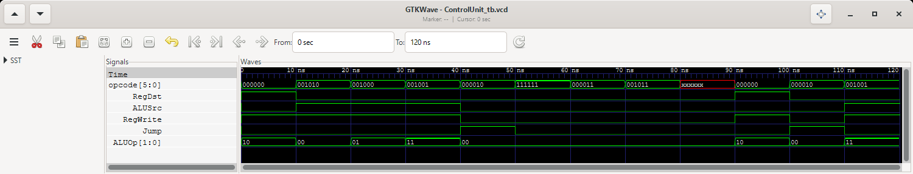

# 04 — Unidad de Control (ControlUnit)

**Entrega 2 · Ejercicio 1** · Estado: ✅ implementado y verificado (12/12 pruebas OK) · capturas listas

## Objetivo
Decodificar el `opcode` de la instrucción y generar las señales que controlan el resto del procesador. Es
lógica combinacional pura: no tiene reloj ni estado.

| Archivo | Contenido |
|---|---|
| `ControlUnit.v` | Módulo `ControlUnit` |
| `ControlUnit_tb.v` | Testbench `ControlUnit_tb`, con 12 pruebas comprobadas |
| `ControlUnit_tb.gtkw` | Vista guardada de GTKWave: `opcode` y las cinco señales en binario |

## Puertos

| Puerto | Dirección | Ancho | Descripción |
|---|---|---|---|
| `opcode` | input | 6 | Código de operación: `instruction[31:26]` |
| `RegDst` | output reg | 1 | 1 = se escribe en `rd` (tipo R); 0 = en `rt` (tipo I) |
| `ALUSrc` | output reg | 1 | 1 = el segundo operando de la ALU es el inmediato |
| `RegWrite` | output reg | 1 | Habilita la escritura en el banco de registros |
| `Jump` | output reg | 1 | Salto incondicional: `PC = address` |
| `ALUOp` | output reg | 2 | Clase de operación para ALUControl |

## Tabla de verdad implementada
Orden de las señales de la plantilla: RegDst · ALUSrc · RegWrite · Jump · ALUOp. En **negrita**, los valores que
el enunciado deja como «—» o no menciona, decididos por el grupo (decisiones 2 y 3 del README principal).

| Tipo | Opcode | RegDst | ALUSrc | RegWrite | Jump | ALUOp | Señales |
|---|:---:|:---:|:---:|:---:|:---:|:---:|:---:|
| R (ADD, SUB, MUL, DIV, MOV) | `000000` | 1 | 0 | 1 | **0** | `10` | `1 0 1 0 10` |
| MOVI | `001010` | 0 | 1 | 1 | **0** | `00` | `0 1 1 0 00` |
| ADDI | `001000` | **0** | **1** | **1** | **0** | **`01`** | `0 1 1 0 01` |
| SUBI | `001001` | **0** | **1** | **1** | **0** | **`11`** | `0 1 1 0 11` |
| JUMP | `000010` | **0** | **0** | **0** | 1 | **`00`** | `0 0 0 1 00` |
| No definido | otro, o con bits `x`/`z` | **0** | **0** | **0** | **0** | **`00`** | `0 0 0 0 00` |

## Decisiones de diseño

1. **Todas las salidas tienen un valor concreto, sin `x`** (decisión 3). El enunciado deja como «—» `Jump` en
   R e I, y `RegDst`, `ALUSrc`, `RegWrite` y `ALUOp` en J. Un `x` como «no importa» complicaría el testbench,
   que no podría comparar las cinco señales con `!==`, y en la Fase 4 propagaría `x` por el datapath.
2. **JUMP no escribe registros: `RegWrite = 0`.** Es lo único que importa en una J además de `Jump = 1`: un
   salto no produce resultado. `RegDst`, `ALUSrc` y `ALUOp` no afectan nada cuando no se escribe, así que se
   dejan en `0`, los valores por defecto. Por eso la rama de JUMP solo asigna `Jump`.
3. **`ALUOp = 01` → ADDI y `ALUOp = 11` → SUBI** (decisión 2). El enunciado solo define `00` (MOVI) y `10`
   (tipo R). Si ADDI y SUBI usaran `00`, ALUControl pediría la operación de MOVI y la ALU devolvería solo el
   inmediato. ALUControl ya decodifica `01` como suma y `11` como resta.
4. **Opcode no definido → estado seguro `0 0 0 0 00`:** no escribe registros ni salta. En la Fase 4 se
   comporta como un `nop`: el PC avanza `+1` y nada más cambia. Esto incluye un opcode con bits `x`, que es lo
   que lee la IMEM en las palabras 10 a 15.

## Cómo funciona el código
```verilog
always @(*) begin
    RegDst   = 1'b0;          // valores por defecto: no escribe ni salta
    ALUSrc   = 1'b0;
    RegWrite = 1'b0;
    Jump     = 1'b0;
    ALUOp    = 2'b00;

    case (opcode)
        6'b000000: begin RegDst = 1'b1; RegWrite = 1'b1; ALUOp = 2'b10; end  // tipo R
        6'b001010: begin ALUSrc = 1'b1; RegWrite = 1'b1; end                 // MOVI
        6'b001000: begin ALUSrc = 1'b1; RegWrite = 1'b1; ALUOp = 2'b01; end  // ADDI
        6'b001001: begin ALUSrc = 1'b1; RegWrite = 1'b1; ALUOp = 2'b11; end  // SUBI
        6'b000010: begin Jump = 1'b1; end                                    // JUMP
        default: ;                                                           // no definido
    endcase
end
```
- `always @(*)` se reevalúa en cuanto cambia `opcode`. Las salidas se declaran `output reg` solo porque se
  asignan dentro de un `always`; no guardan ningún valor entre ciclos.
- **Valores por defecto antes del `case`:** las cinco salidas reciben el estado seguro al inicio de cada
  evaluación y cada rama solo cambia las señales que difieren de él. Una señal que una rama no toca conserva
  el valor por defecto. Sin ellos, Verilog infiere un *latch*: la señal guarda el valor de la instrucción
  anterior, o vale `x` si nunca se asignó. El testbench lo detecta (ver abajo).
- **El `default` vacío** deja los valores por defecto. También atrapa un `opcode` con bits `x` o `z`, porque
  ninguna de las etiquetas del `case` coincide con él.
- **ControlUnit no mira `funct`:** las cinco instrucciones R comparten el opcode `000000` y reciben las mismas
  señales. La operación concreta la elige ALUControl a partir de `funct`.

## Interacción con los otros módulos

ControlUnit recibe el opcode de la IMEM y reparte sus señales por el datapath, que se integra en la Fase 4 del
README principal (fuera del alcance de esta práctica). Por ahora el testbench prueba el módulo aislado.

```
  IMEM: instruction[31:26] (opcode)
            │
            ▼
       ControlUnit ──── RegDst ───► mux: write_reg = rd (1) o rt (0)  ─► RegisterFile
            │      ──── RegWrite ─► RegisterFile: habilita la escritura en el flanco ↑
            │      ──── ALUSrc ───► mux: src2 = inmediato extendido (1) o read_data2 (0) ─► ALU
            │      ──── Jump ─────► mux: next_pc = address (1) o current_pc + 1 (0) ─► PC
            │  ALUOp [1:0]
            ▼
       ALUControl ◄─── IMEM: instruction[5:0] (funct)
```

| Señal | Va a | Efecto |
|---|---|---|
| `RegDst` | Mux del registro destino → RegisterFile `write_reg` | `1`: `rd = instruction[15:11]` (tipo R); `0`: `rt = instruction[20:16]` (tipo I) |
| `ALUSrc` | Mux del segundo operando → ALU `src2` | `1`: inmediato extendido con signo a 32 bits; `0`: `read_data2` |
| `RegWrite` | RegisterFile `RegWrite` | `1`: guarda el resultado de la ALU en el siguiente flanco de subida |
| `Jump` | Mux del siguiente PC → PC `next_pc` | `1`: `address = instruction[25:0]`, dirección de palabra directa; `0`: `current_pc + 1` |
| `ALUOp` | ALUControl `ALUOp` | `00` MOVI, `01` ADDI, `10` tipo R (decodifica `funct`), `11` SUBI |

### Señales para el programa de la IMEM
Lo que generará ControlUnit cuando el datapath ejecute el programa precargado en `02_IMEM`:

| Dir | Instrucción | Opcode | Señales | Qué hace |
|---|---|:---:|:---:|---|
| 0 | `add $3, $1, $2` | `000000` | `1 0 1 0 10` | Escribe en `rd = $3` |
| 1 | `addi $9, $8, 10` | `001000` | `0 1 1 0 01` | Suma el inmediato y escribe en `rt = $9` |
| 2 | `movi $1, 7` | `001010` | `0 1 1 0 00` | Escribe el inmediato en `rt = $1` |
| 3 | `movi $2, -3` | `001010` | `0 1 1 0 00` | Escribe el inmediato en `rt = $2` |
| 4 | `sub $4, $1, $2` | `000000` | `1 0 1 0 10` | Escribe en `rd = $4` |
| 5 | `mul $5, $1, $2` | `000000` | `1 0 1 0 10` | Escribe en `rd = $5` |
| 6 | `div $6, $5, $1` | `000000` | `1 0 1 0 10` | Escribe en `rd = $6` |
| 7 | `subi $7, $9, 15` | `001001` | `0 1 1 0 11` | Resta el inmediato y escribe en `rt = $7` |
| 8 | `mov $10, $7` | `000000` | `1 0 1 0 10` | Escribe en `rd = $10` |
| 9 | `j 9` | `000010` | `0 0 0 1 00` | `PC = 9`, sin escribir registros |
| 10–15 | sin instrucción | `xxxxxx` | `0 0 0 0 00` | Nada (no se alcanzan: `j 9` salta a sí misma) |

## Testbench (`ControlUnit_tb.v`)
- Tarea `probar(opcode, esperado, caso)`: pone el opcode, espera 10 ns y compara las cinco salidas a la vez.
  El esperado es un vector de 6 bits con las señales en el orden de la plantilla, `{RegDst, ALUSrc, RegWrite,
  Jump, ALUOp}`, y se escribe a mano separado por `_`: `6'b1_0_1_0_10` para tipo R.
- Compara con `!==`, así que una `x` en cualquier salida cuenta como error.
- No usa reloj: el módulo es combinacional, basta con que las salidas se asienten. Cada prueba dura 10 ns, que
  es el «ciclo» en el que cambia el opcode.
- Imprime una línea por opcode con el formato sugerido por la plantilla, más el esperado, `OK`/`ERROR` y el
  nombre del caso. Al final imprime el total de pruebas y si hubo errores.
- La secuencia del caso 6 (R → J → SUBI) hace que cada una de las cinco señales cambie al menos una vez, así
  que un valor arrastrado de la instrucción anterior daría `ERROR`.
- `$dumpfile("ControlUnit_tb.vcd")` y `$dumpvars(0, ControlUnit_tb)`.

**El testbench detecta los errores que previene:** se simularon dos copias modificadas de `ControlUnit.v`.
- Sin el valor por defecto de `Jump`: 10 pruebas en `ERROR`. `Jump` vale `x` en las pruebas 1–4 y, después de
  la J, se queda en `1` (pruebas 6–10 y 12): es el *latch* que advierte la plantilla.
- Con `ALUOp = 01` en SUBI: las pruebas 4 y 12 en `ERROR`.

## Casos de prueba (resultados de la simulación)
Señales en el orden RegDst · ALUSrc · RegWrite · Jump · ALUOp.

| # | Caso de prueba | Opcode | Señales esperadas | Señales obtenidas (consola) | ¿OK? |
|---|---|:---:|:---:|:---:|:---:|
| 1 | Tipo R: aritmética entre registros (add, sub, mul, div, mov) | `000000` | `1 0 1 0 10` | `1 0 1 0 10` | ✅ |
| 2 | Tipo I: MOVI, mueve un inmediato a un registro | `001010` | `0 1 1 0 00` | `0 1 1 0 00` | ✅ |
| 3 | Tipo I: otra instrucción · ADDI | `001000` | `0 1 1 0 01` | `0 1 1 0 01` | ✅ |
| 3 | Tipo I: otra instrucción · SUBI | `001001` | `0 1 1 0 11` | `0 1 1 0 11` | ✅ |
| 4 | Tipo J: salto incondicional (JUMP) | `000010` | `0 0 0 1 00` | `0 0 0 1 00` | ✅ |
| 5 | Opcode no definido: «seguro», sin escribir ni saltar | `111111` | `0 0 0 0 00` | `0 0 0 0 00` | ✅ |
| 6 | Secuencia R → J → I: las señales siguen al opcode actual | `000000` → `000010` → `001001` | `1 0 1 0 10` → `0 0 0 1 00` → `0 1 1 0 11` | `1 0 1 0 10` → `0 0 0 1 00` → `0 1 1 0 11` | ✅ |
| 7 | Adicional: a un bit de JUMP, no salta | `000011` | `0 0 0 0 00` | `0 0 0 0 00` | ✅ |
| 8 | Adicional: a un bit de MOVI, no escribe | `001011` | `0 0 0 0 00` | `0 0 0 0 00` | ✅ |
| 9 | Adicional: opcode `x`, el de una palabra vacía de la IMEM | `xxxxxx` | `0 0 0 0 00` | `0 0 0 0 00` | ✅ |

El caso 3 ocupa dos pruebas (ADDI y SUBI) y el caso 6, tres. En la consola, los adicionales (pruebas 7–9) van
antes del caso 6 (pruebas 10–12). **Total: 12 pruebas, 0 errores.**

### Salida de la consola
```
=== Testbench ControlUnit ===
 1  opcode=000000 -> RegDst=1 ALUSrc=0 RegWrite=1 Jump=0 ALUOp=10 | esperado=1 0 1 0 10  OK     Caso 1: tipo R
 2  opcode=001010 -> RegDst=0 ALUSrc=1 RegWrite=1 Jump=0 ALUOp=00 | esperado=0 1 1 0 00  OK     Caso 2: tipo I, MOVI
 3  opcode=001000 -> RegDst=0 ALUSrc=1 RegWrite=1 Jump=0 ALUOp=01 | esperado=0 1 1 0 01  OK     Caso 3: tipo I, ADDI
 4  opcode=001001 -> RegDst=0 ALUSrc=1 RegWrite=1 Jump=0 ALUOp=11 | esperado=0 1 1 0 11  OK     Caso 3: tipo I, SUBI
 5  opcode=000010 -> RegDst=0 ALUSrc=0 RegWrite=0 Jump=1 ALUOp=00 | esperado=0 0 0 1 00  OK     Caso 4: tipo J
 6  opcode=111111 -> RegDst=0 ALUSrc=0 RegWrite=0 Jump=0 ALUOp=00 | esperado=0 0 0 0 00  OK     Caso 5: opcode no definido
 7  opcode=000011 -> RegDst=0 ALUSrc=0 RegWrite=0 Jump=0 ALUOp=00 | esperado=0 0 0 0 00  OK     Adicional: a 1 bit de JUMP
 8  opcode=001011 -> RegDst=0 ALUSrc=0 RegWrite=0 Jump=0 ALUOp=00 | esperado=0 0 0 0 00  OK     Adicional: a 1 bit de MOVI
 9  opcode=xxxxxx -> RegDst=0 ALUSrc=0 RegWrite=0 Jump=0 ALUOp=00 | esperado=0 0 0 0 00  OK     Adicional: opcode x (IMEM vacia)
10  opcode=000000 -> RegDst=1 ALUSrc=0 RegWrite=1 Jump=0 ALUOp=10 | esperado=1 0 1 0 10  OK     Caso 6: secuencia, R
11  opcode=000010 -> RegDst=0 ALUSrc=0 RegWrite=0 Jump=1 ALUOp=00 | esperado=0 0 0 1 00  OK     Caso 6: secuencia, J
12  opcode=001001 -> RegDst=0 ALUSrc=1 RegWrite=1 Jump=0 ALUOp=11 | esperado=0 1 1 0 11  OK     Caso 6: secuencia, I (SUBI)
=== 12 pruebas, todas las pruebas OK ===
ControlUnit_tb.v:90: $finish called at 120000 (1ps)
```

## Capturas
- [`consola.png`](consola.png): ejecución con `vvp` y las 12 líneas de prueba.
- [`gtkwave.png`](gtkwave.png): `ControlUnit_tb.gtkw` abre `opcode` en binario, las cuatro señales de 1 bit y
  `ALUOp` como bus de 2 bits; después, View → *Zoom Fit* (0–120 ns, las 12 pruebas a la vista). En la prueba 9
  (80–90 ns) `opcode` aparece en rojo (`x`) mientras las cinco señales siguen en `0`.



## Comandos
```powershell
iverilog -o ControlUnit_tb.vvp ControlUnit.v ControlUnit_tb.v
vvp ControlUnit_tb.vvp
gtkwave ControlUnit_tb.vcd ControlUnit_tb.gtkw    # abre ya las 6 señales; luego View → Zoom Fit
```
