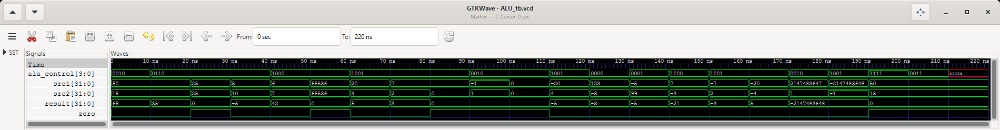

# 05 — Unidad Aritmético-Lógica (ALU)

**Entrega 2 · Ejercicio 2** · Estado: ✅ implementado y verificado (22/22 pruebas OK) · capturas listas

## Objetivo
Realizar suma, resta, multiplicación y división sobre dos operandos de 32 bits e indicar con `zero` si el
resultado es cero. Es lógica combinacional pura: no tiene reloj ni estado.

| Archivo | Contenido |
|---|---|
| `ALU.v` | Módulo `ALU` |
| `ALU_tb.v` | Testbench `ALU_tb`, con 22 pruebas comprobadas |
| `ALU_tb.gtkw` | Vista guardada de GTKWave: control en binario, operandos y resultado en decimal con signo, `zero` |

## Puertos

| Puerto | Dirección | Ancho | Descripción |
|---|---|---|---|
| `src1` | input | 32 | Primer operando: `read_data1` (`$rs`) |
| `src2` | input | 32 | Segundo operando: `read_data2` (`$rt`) o el inmediato extendido con signo |
| `alu_control` | input | 4 | Operación a realizar, generada por ALUControl |
| `result` | output reg | 32 | Resultado: va a `write_data` del banco de registros |
| `zero` | output | 1 | 1 cuando `result == 0` |

## Codificación del control
Es la misma que genera ALUControl (entrega 3), así que la ALU no cambia al integrarla.

| Operación | Control (4 bits) | `result` | Instrucciones |
|---|:---:|---|---|
| Suma | `0010` | `src1 + src2` (módulo 2³²) | ADD, ADDI |
| Resta | `0110` | `src1 - src2` (módulo 2³²) | SUB, SUBI |
| Multiplicación | `1000` | `src1 * src2`, los 32 bits bajos del producto | MUL |
| División | `1001` | `$signed(src1) / $signed(src2)`, truncada hacia cero; **`0` si `src2 = 0`** | DIV |
| Control no definido | otro (`1111`, `0011`, `xxxx`…) | **`0`** (y `zero = 1`) | — |
| Adicional: pasar `src2` | `0000` | `src2` | MOVI |
| Adicional: pasar `src1` | `0001` | `src1` | MOV |

## Decisiones de diseño

1. **Todas las operaciones son con signo** (complemento a 2; decisión 4 del README principal). El programa de
   la IMEM usa negativos (`movi $2, -3`) y el inmediato se extiende con signo. En suma, resta y multiplicación
   los 32 bits del resultado son los mismos con o sin signo, así que solo la división necesita `$signed`. Sin
   él, `-20 / 4` daría `1073741819` (prueba 12) y `div $6, $5, $1` del programa daría `613566753` en vez de
   `-3`.
2. **División entre cero → `result = 0`**, con `zero = 1`. Sin protección, Icarus devuelve `x` en `result` y
   en `zero`, y la `x` llegaría al banco de registros en la Fase 4. Con `0` el comportamiento es determinista.
3. **Control no definido → `result = 0`**, con `zero = 1`. Es el valor por defecto del `always`, así que cubre
   el `1111` que ALUControl emite para combinaciones inválidas, cualquier otro código sin operación y un
   control con bits `x`/`z`.
4. **Los desbordes no se señalan:** el resultado da la vuelta módulo 2³², como en la `addu`/`mul` de MIPS.
   `0xFFFFFFFF + 1 = 0`, `65536 × 65536 = 0` y `2147483647 + 1 = -2147483648`. La única división que desborda,
   `-2147483648 / -1`, también da la vuelta y queda en `-2147483648`.
5. **`zero` no depende de la operación:** sube con cualquier resultado `0`, incluidos los de la división entre
   cero y el control no definido. Ninguna instrucción actual la usa; en un MIPS completo sería la base de `beq`.

## Cómo funciona el código
```verilog
always @(*) begin
    result = 32'd0;                                  // por defecto: control no definido y /0
    case (alu_control)
        4'b0000: result = src2;                      // MOVI
        4'b0001: result = src1;                      // MOV
        4'b0010: result = src1 + src2;               // ADD, ADDI
        4'b0110: result = src1 - src2;               // SUB, SUBI
        4'b1000: result = src1 * src2;               // MUL: se trunca a 32 bits
        4'b1001: begin                               // DIV con signo
            if (src2 != 32'd0)
                result = $signed(src1) / $signed(src2);
        end
        default: ;                                   // 1111 y demás → 0
    endcase
end

assign zero = (result == 32'd0);
```
- `always @(*)` se reevalúa en cuanto cambia una entrada. `result` se declara `output reg` solo porque se
  asigna dentro de un `always`; no guarda ningún valor entre ciclos.
- **Valor por defecto antes del `case`:** `result = 0` al inicio de cada evaluación. Sirve para tres cosas: es
  lo que devuelve un control no definido (el `default` vacío lo deja), es lo que devuelve la división entre
  cero (el `if` no asigna nada) y evita el *latch*: sin él, `result` conservaría el valor de la operación
  anterior. El testbench lo detecta (ver abajo).
- **`$signed` solo en la división:** un vector de Verilog es sin signo; `$signed` hace que `/` lo interprete
  en complemento a 2. Una expresión es con signo solo si **todos** sus operandos lo son.
- **Por qué `if` y no `?:`:** la forma compacta `(src2 == 0) ? 32'd0 : $signed(src1) / $signed(src2)` divide
  **sin signo**. El literal `32'd0` es sin signo, contagia a todo el `?:` y anula los `$signed`. El `if`
  separa la división en su propia asignación, donde los dos operandos son con signo.
- **`zero` es un `assign` aparte:** depende solo de `result`, así que no hace falta repetirlo en cada rama.

## Interacción con los otros módulos

La ALU recibe sus operandos del banco de registros y del inmediato, y la operación de ALUControl. Se integrará
en el datapath en la Fase 4 del README principal (fuera del alcance de esta práctica); por ahora el testbench
prueba el módulo aislado.

```
  RegisterFile ── read_data1 ($rs) ──────────────────────────────► src1
               ── read_data2 ($rt) ──► mux ALUSrc ──────────────► src2      ALU ── result ──► RegisterFile
  IMEM: instr[15:0] ─► extensión de signo ─┘ (1 = inmediato)                    │              (write_data)
                                                                                └── zero (sin uso por ahora)
  ControlUnit ── ALUOp ──► ALUControl ◄── IMEM: instr[5:0] (funct)
                               └── alu_control ─────────────────► alu_control
```

| Puerto | Viene de / va a | Detalle |
|---|---|---|
| `src1` | RegisterFile `read_data1` | Siempre `$rs = instruction[25:21]` |
| `src2` | Mux `ALUSrc` | `0`: `read_data2` (`$rt`, tipo R); `1`: inmediato extendido con signo (MOVI, ADDI, SUBI) |
| `alu_control` | ALUControl | Mismos códigos que la tabla de arriba |
| `result` | RegisterFile `write_data` | Se guarda en el siguiente flanco de subida si `RegWrite = 1` |
| `zero` | — | Ninguna instrucción de esta ISA la usa |

### Resultados para el programa de la IMEM
Lo que calculará la ALU cuando el datapath ejecute el programa precargado en `02_IMEM`, con los registros
empezando en `0`. Las pruebas 13–15 del testbench cubren `movi`, `mov` y `mul` con estos mismos signos.

| Dir | Instrucción | `alu_control` | `src1` | `src2` | `result` | `zero` |
|---|---|:---:|---:|---:|---:|:---:|
| 0 | `add $3, $1, $2` | `0010` | `$1 = 0` | `$2 = 0` | `0` | 1 |
| 1 | `addi $9, $8, 10` | `0010` | `$8 = 0` | `10` | `10` | 0 |
| 2 | `movi $1, 7` | `0000` | `$0 = 0` | `7` | `7` | 0 |
| 3 | `movi $2, -3` | `0000` | `$0 = 0` | `-3` | `-3` | 0 |
| 4 | `sub $4, $1, $2` | `0110` | `7` | `-3` | `10` | 0 |
| 5 | `mul $5, $1, $2` | `1000` | `7` | `-3` | `-21` | 0 |
| 6 | `div $6, $5, $1` | `1001` | `-21` | `7` | `-3` | 0 |
| 7 | `subi $7, $9, 15` | `0110` | `10` | `15` | `-5` | 0 |
| 8 | `mov $10, $7` | `0001` | `-5` | `$0 = 0` | `-5` | 0 |
| 9 | `j 9` | `0000` | `$0 = 0` | `$0 = 0` | `0`, no se escribe (`RegWrite = 0`) | 1 |

## Testbench (`ALU_tb.v`)
- Tarea `probar(ctl, a, b, esperado, esperado_zero, caso)`: pone el control y los operandos, espera 10 ns y
  compara `result` y `zero` con lo esperado. Los valores se escriben en decimal con signo (`-3` queda como
  `0xFFFFFFFD`) o en hexadecimal (`32'h80000000`).
- Compara con `!==`, así que una `x` en `result` o en `zero` cuenta como error.
- No usa reloj: el módulo es combinacional, basta con que las salidas se asienten. Cada prueba dura 10 ns.
- Imprime una línea por prueba con el formato sugerido por la plantilla (control, operandos, resultado en
  decimal con signo y en hexadecimal, `zero`), más el esperado, `OK`/`ERROR` y el nombre del caso. `%6d`
  alinea las columnas; un valor más ancho, como `-2147483648`, ocupa lo que necesita. Al final imprime el
  total de pruebas y si hubo errores.
- Tres grupos: los 12 casos de la plantilla (pruebas 1–12), las operaciones de paso y casos de signo y desborde
  (13–19) y el control no definido (20–22).
- `$dumpfile("ALU_tb.vcd")` y `$dumpvars(0, ALU_tb)`.

**El testbench detecta los errores que previene:** se simularon cuatro copias modificadas de `ALU.v`.
- División sin `$signed` (`src1 / src2`): pruebas 12, 16, 17 y 19 en `ERROR`; `-20 / 4` da `1073741819`.
- División con la forma compacta `?:` y `32'd0`: las mismas 4 pruebas en `ERROR`, con los mismos valores que
  la división sin signo. Confirma la trampa descrita arriba.
- Sin el `if` de la división entre cero: la prueba 9 en `ERROR`, con `result = x` y `zero = x`.
- Sin el valor por defecto `result = 32'd0`: pruebas 9 y 20–22 en `ERROR`. Es el *latch*: `7 / 0` conserva el
  `3` de la prueba 8, y los controles no definidos, el `-2147483648` de la prueba 19.

## Casos de prueba (resultados de la simulación)

| # | Caso de prueba | Control | Operando 1 | Operando 2 | Esperado: resultado | Cero | Obtenido: resultado | Cero | ¿OK? |
|---|---|:---:|---:|---:|---:|:---:|---:|:---:|:---:|
| 1 | Suma: dos positivos pequeños | `0010` | `50` | `15` | `65` | 0 | `65` | 0 | ✅ |
| 2 | Resta positiva: operando 1 > operando 2 | `0110` | `50` | `15` | `35` | 0 | `35` | 0 | ✅ |
| 3 | Resta con resultado 0: la bandera sube | `0110` | `25` | `25` | `0` | 1 | `0` | 1 | ✅ |
| 4 | Resta negativa: complemento a 2 | `0110` | `5` | `10` | `-5` (`0xFFFFFFFB`) | 0 | `-5` (`0xfffffffb`) | 0 | ✅ |
| 5 | Multiplicación: dos positivos pequeños | `1000` | `6` | `7` | `42` | 0 | `42` | 0 | ✅ |
| 6 | Multiplicación con overflow: 2³² se trunca | `1000` | `65536` | `65536` | `0` | 1 | `0` | 1 | ✅ |
| 7 | División exacta | `1001` | `20` | `4` | `5` | 0 | `5` | 0 | ✅ |
| 8 | División con residuo: se trunca | `1001` | `7` | `2` | `3` | 0 | `3` | 0 | ✅ |
| 9 | División entre cero: devuelve 0 (decisión 2) | `1001` | `7` | `0` | `0` | 1 | `0` | 1 | ✅ |
| 10 | Suma con overflow: da la vuelta a 0 | `0010` | `0xFFFFFFFF` (`-1`) | `1` | `0` | 1 | `0` | 1 | ✅ |
| 11 | Operandos en cero | `0010` | `0` | `0` | `0` | 1 | `0` | 1 | ✅ |
| 12 | División con negativo: con signo (sin signo daría `1073741819`) | `1001` | `-20` | `4` | `-5` | 0 | `-5` | 0 | ✅ |
| 13 | Adicional: MOVI pasa `src2` e ignora `src1` | `0000` | `123` | `-3` | `-3` | 0 | `-3` | 0 | ✅ |
| 14 | Adicional: MOV pasa `src1` e ignora `src2` | `0001` | `-5` | `99` | `-5` | 0 | `-5` | 0 | ✅ |
| 15 | Adicional: multiplicación con negativo | `1000` | `7` | `-3` | `-21` | 0 | `-21` | 0 | ✅ |
| 16 | Adicional: `-7 / 2` trunca hacia cero, no a `-4` | `1001` | `-7` | `2` | `-3` | 0 | `-3` | 0 | ✅ |
| 17 | Adicional: división de dos negativos | `1001` | `-20` | `-4` | `5` | 0 | `5` | 0 | ✅ |
| 18 | Adicional: suma con overflow con signo | `0010` | `2147483647` | `1` | `-2147483648` (`0x80000000`) | 0 | `-2147483648` | 0 | ✅ |
| 19 | Adicional: `-2147483648 / -1` da la vuelta | `1001` | `-2147483648` | `-1` | `-2147483648` | 0 | `-2147483648` | 0 | ✅ |
| 20 | Adicional: control `1111`, el no definido de ALUControl | `1111` | `50` | `15` | `0` | 1 | `0` | 1 | ✅ |
| 21 | Adicional: control sin operación asignada | `0011` | `50` | `15` | `0` | 1 | `0` | 1 | ✅ |
| 22 | Adicional: control con bits `x` | `xxxx` | `50` | `15` | `0` | 1 | `0` | 1 | ✅ |

Las pruebas 1–12 son los casos mínimos de la plantilla, en el mismo orden; las 13–22 van en su fila 13
(«Caso adicional»). **Total: 22 pruebas, 0 errores.**

### Salida de la consola
```
=== Testbench ALU ===
 1  ctl=0010 src1=    50 src2=    15 -> result=    65 (0x00000041) zero=0 | esperado=    65 zero=0  OK     Caso 1: suma de positivos
 2  ctl=0110 src1=    50 src2=    15 -> result=    35 (0x00000023) zero=0 | esperado=    35 zero=0  OK     Caso 2: resta positiva
 3  ctl=0110 src1=    25 src2=    25 -> result=     0 (0x00000000) zero=1 | esperado=     0 zero=1  OK     Caso 3: resta con resultado 0
 4  ctl=0110 src1=     5 src2=    10 -> result=    -5 (0xfffffffb) zero=0 | esperado=    -5 zero=0  OK     Caso 4: resta negativa
 5  ctl=1000 src1=     6 src2=     7 -> result=    42 (0x0000002a) zero=0 | esperado=    42 zero=0  OK     Caso 5: multiplicacion de positivos
 6  ctl=1000 src1= 65536 src2= 65536 -> result=     0 (0x00000000) zero=1 | esperado=     0 zero=1  OK     Caso 6: multiplicacion con overflow
 7  ctl=1001 src1=    20 src2=     4 -> result=     5 (0x00000005) zero=0 | esperado=     5 zero=0  OK     Caso 7: division exacta
 8  ctl=1001 src1=     7 src2=     2 -> result=     3 (0x00000003) zero=0 | esperado=     3 zero=0  OK     Caso 8: division con residuo
 9  ctl=1001 src1=     7 src2=     0 -> result=     0 (0x00000000) zero=1 | esperado=     0 zero=1  OK     Caso 9: division entre cero
10  ctl=0010 src1=    -1 src2=     1 -> result=     0 (0x00000000) zero=1 | esperado=     0 zero=1  OK     Caso 10: suma con overflow
11  ctl=0010 src1=     0 src2=     0 -> result=     0 (0x00000000) zero=1 | esperado=     0 zero=1  OK     Caso 11: operandos en cero
12  ctl=1001 src1=   -20 src2=     4 -> result=    -5 (0xfffffffb) zero=0 | esperado=    -5 zero=0  OK     Caso 12: division con negativo
13  ctl=0000 src1=   123 src2=    -3 -> result=    -3 (0xfffffffd) zero=0 | esperado=    -3 zero=0  OK     Adicional: MOVI pasa src2
14  ctl=0001 src1=    -5 src2=    99 -> result=    -5 (0xfffffffb) zero=0 | esperado=    -5 zero=0  OK     Adicional: MOV pasa src1
15  ctl=1000 src1=     7 src2=    -3 -> result=   -21 (0xffffffeb) zero=0 | esperado=   -21 zero=0  OK     Adicional: multiplicacion con negativo
16  ctl=1001 src1=    -7 src2=     2 -> result=    -3 (0xfffffffd) zero=0 | esperado=    -3 zero=0  OK     Adicional: -7 / 2 trunca hacia cero
17  ctl=1001 src1=   -20 src2=    -4 -> result=     5 (0x00000005) zero=0 | esperado=     5 zero=0  OK     Adicional: division de dos negativos
18  ctl=0010 src1=2147483647 src2=     1 -> result=-2147483648 (0x80000000) zero=0 | esperado=-2147483648 zero=0  OK     Adicional: suma con overflow con signo
19  ctl=1001 src1=-2147483648 src2=    -1 -> result=-2147483648 (0x80000000) zero=0 | esperado=-2147483648 zero=0  OK     Adicional: -2147483648 / -1
20  ctl=1111 src1=    50 src2=    15 -> result=     0 (0x00000000) zero=1 | esperado=     0 zero=1  OK     Adicional: control 1111 (de ALUControl)
21  ctl=0011 src1=    50 src2=    15 -> result=     0 (0x00000000) zero=1 | esperado=     0 zero=1  OK     Adicional: control sin operacion
22  ctl=xxxx src1=    50 src2=    15 -> result=     0 (0x00000000) zero=1 | esperado=     0 zero=1  OK     Adicional: control x
=== 22 pruebas, todas las pruebas OK ===
ALU_tb.v:117: $finish called at 220000 (1ps)
```

## Capturas
- `consola.png` ✅: comandos `iverilog` y `vvp`, y las 22 líneas de prueba.
- [`gtkwave.png`](gtkwave.png): `ALU_tb.gtkw` abre `alu_control` en binario, `src1`, `src2` y `result` en
  *Signed Decimal* y `zero`, en una ventana de 1900 px para que quepan las 22 pruebas; después, View →
  *Zoom Fit* (0–220 ns). GTKWave une los valores iguales consecutivos, por eso `-2147483648` ocupa las
  pruebas 18–19 en `result`. En la prueba 22 (210–220 ns) `alu_control` aparece en rojo (`xxxx`) mientras
  `result = 0` y `zero = 1`.



## Comandos
```powershell
iverilog -o ALU_tb.vvp ALU.v ALU_tb.v
vvp ALU_tb.vvp
gtkwave ALU_tb.vcd ALU_tb.gtkw    # abre ya las 5 señales con su formato; luego View → Zoom Fit
```
