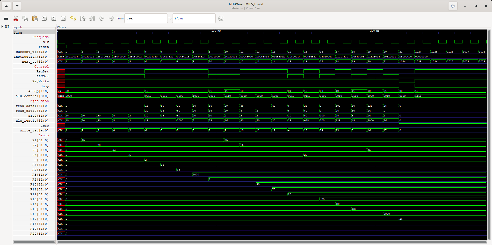

# 08 — Procesador MIPS completo (datapath monociclo)

**Fase 4 · Integración → Entrega Final 1** · Estado: ✅ implementado y verificado con el programa de clase
(reset, 26/26 ciclos y 32/32 registros OK) · faltan `consola.png` y la foto del CMD

## Objetivo
Conectar los seis módulos en un procesador que ejecute el programa de la IMEM de principio a fin: una
instrucción por ciclo, con el resultado guardado en el banco de registros y el siguiente PC elegido entre
`PC + 1` y la dirección del salto. Para la Entrega Final el programa son las **26 instrucciones binarias de
clase** (ver [`02_IMEM`](../02_IMEM/README.md)).

| Archivo | Contenido |
|---|---|
| `MIPS.v` | Módulo superior `MIPS`: seis instancias y la interconexión, toda con `assign` |
| `MIPS_tb.v` | Testbench `MIPS_tb`: reset, 26 ciclos comprobados señal por señal y estado final de los 32 registros |
| `MIPS_tb.gtkw` | Vista guardada de GTKWave: búsqueda, control, ejecución y registros `$1`–`$20` |
| `gtkwave.png` | Captura de GTKWave |

Reutiliza, sin copiarlos ni modificarlos, `../01_PC/PC.v`, `../02_IMEM/IMEM.v`,
`../04_ControlUnit/ControlUnit.v`, `../05_ALU/ALU.v`, `../06_ALUControl/ALUControl.v` y
`../07_RegisterFile/RegisterFile.v`.

## Puertos

| Puerto | Dirección | Ancho | Descripción |
|---|---|---|---|
| `clk` | input | 1 | Reloj del PC y del banco de registros |
| `reset` | input | 1 | Reinicio síncrono, activo en alto: `PC = 0` y los 32 registros en `0` |
| `current_pc` | output | 32 | Dirección de la instrucción en ejecución |
| `instruction` | output | 32 | Instrucción en ejecución |
| `alu_result` | output | 32 | Resultado de la ALU: se escribe en el banco si `RegWrite = 1` |

Las salidas permiten observar el procesador desde fuera. Las señales internas (control, operandos, destino,
siguiente PC) se leen en el testbench con una referencia jerárquica: `uut.RegDst`, `uut.src2`, etc.

## Conexión

```
BÚSQUEDA        pc_reg ── current_pc ──► imem ──► instruction
                                                   ├─ opcode    [31:26] ──► cu
                                                   ├─ rs        [25:21] ──► rf.read_reg1
                                                   ├─ rt        [20:16] ──► rf.read_reg2 y mux RegDst
                                                   ├─ rd        [15:11] ──► mux RegDst
                                                   ├─ funct     [5:0]   ──► aluc
                                                   ├─ immediate [15:0]  ──► extensión de signo
                                                   └─ address   [25:0]  ──► mux Jump

DECODIFICACIÓN  cu   : opcode ──► RegDst, ALUSrc, RegWrite, Jump, ALUOp
                aluc : ALUOp + funct ──► alu_control
                rf   : rs, rt ──► read_data1 ($rs), read_data2 ($rt)
                imm_ext = {{16{immediate[15]}}, immediate}

EJECUCIÓN       src2 = ALUSrc ? imm_ext : read_data2
                alu  : read_data1, src2, alu_control ──► alu_result, zero

ESCRITURA       write_reg  = RegDst ? rd : rt
                write_data = alu_result          → rf lo guarda en el flanco ↑ si RegWrite = 1

SIGUIENTE PC    pc_plus1 = current_pc + 1
                next_pc  = Jump ? {6'b000000, address} : pc_plus1   → pc_reg lo carga en el flanco ↑
```

### Instancias

| Instancia | Módulo | Entradas | Salidas |
|---|---|---|---|
| `pc_reg` | `PC` | `clk`, `reset`, `next_pc` | `current_pc` |
| `imem` | `IMEM` | `current_pc` | `instruction` |
| `cu` | `ControlUnit` | `opcode` | `RegDst`, `ALUSrc`, `RegWrite`, `Jump`, `ALUOp` |
| `aluc` | `ALUControl` | `ALUOp`, `funct` | `alu_control` |
| `rf` | `RegisterFile` | `clk`, `reset`, `RegWrite`, `rs`, `rt`, `write_reg`, `write_data` | `read_data1`, `read_data2` |
| `alu` | `ALU` | `read_data1`, `src2`, `alu_control` | `alu_result`, `zero` |

### Interconexión: solo `assign`

| Pieza | `assign` | Ancho | Por qué así |
|---|---|:---:|---|
| Campos | `opcode = instruction[31:26]`, `rs = [25:21]`, `rt = [20:16]`, `rd = [15:11]`, `funct = [5:0]`, `immediate = [15:0]`, `address = [25:0]` | — | Se cortan todos; cada módulo o mux toma el que le corresponde. `shamt` no se usa |
| Extensión de signo | `imm_ext = {{16{immediate[15]}}, immediate}` | 16 → 32 | D7: la ALU es con signo; un inmediato negativo (`-3`) debe llegar como `0xFFFFFFFD` |
| Mux `RegDst` | `write_reg = RegDst ? rd : rt` | 5 | Las R escriben en `rd`; las I, en `rt` |
| Mux `ALUSrc` | `src2 = ALUSrc ? imm_ext : read_data2` | 32 | El segundo operando es un registro (R) o el inmediato (I) |
| Write-back | `write_data = alu_result` | 32 | Sin memoria de datos no hace falta el mux `MemtoReg` |
| Sumador | `pc_plus1 = current_pc + 32'd1` | 32 | D6: direccionamiento por palabra |
| Mux `Jump` | `next_pc = Jump ? {6'b000000, address} : pc_plus1` | 32 | D8: dirección de palabra directa, completada con ceros |

## Decisiones de diseño

1. **La interconexión es solo `assign`.** Son piezas combinacionales sin estado: un `assign` por pieza se lee
   igual que la ecuación del datapath ([Arquitectura §5.8](../docs/Arquitectura.md#s5-8)) y no hace falta un
   módulo con su propio testbench para un mux de dos entradas. `MIPS.v` no tiene ningún `always`: todo el
   comportamiento secuencial está dentro del PC y del banco.
2. **Los módulos no se tocan.** Se compilan desde su carpeta; el datapath usa exactamente el código verificado
   de cada módulo.
3. **Mismo `clk` y `reset` para el PC y el banco.** Los dos son síncronos y se actualizan en el mismo flanco.
   Con `<=` el banco guarda el resultado de la instrucción que termina, no el de la siguiente
   ([Arquitectura §6.2](../docs/Arquitectura.md#s6)).
4. **Nombres de instancia cortos.** `rf` permite leer el arreglo del banco desde el testbench con
   `uut.rf.registers[i]` (la «referencia jerárquica» de la plantilla: `instancia.banco.registros[i]`).
5. **`zero` queda sin usar.** Ninguna instrucción de esta ISA la consulta; está conectada a un `wire` para un
   futuro `beq`.
6. **Sin etapa Memory.** El datapath de referencia trae DMEM, `MemRead`, `MemWrite` y `MemtoReg`, pero la ISA
   no tiene `lw` ni `sw`. No se implementan: equivale a `MemRead = MemWrite = 0` y `MemtoReg = 0` fijos, así
   que al banco siempre llega el resultado de la ALU (`write_data = alu_result`).

### Hallazgo: antes del primer flanco `RegWrite` vale `x`, no `0`
Un `always @(*)` solo se ejecuta cuando cambia una de sus entradas. Antes del primer flanco el `opcode` vale
`x` desde el instante 0 y no cambia hasta que el reset pone el PC en 0 (5 ns), así que los `always` de
ControlUnit, ALUControl y ALU todavía no se han ejecutado y sus salidas conservan el valor inicial `x`. En
GTKWave se ven en rojo de 0 a 5 ns. No hay riesgo: en ese primer flanco `reset = 1` y **el reset del banco
tiene prioridad sobre `RegWrite`**, así que no hay escrituras espurias. El testbench lo comprueba a los 6 ns
(PC en 0 y los 32 registros en 0).

## Entrega Final 1: cómo responde el diseño

### El ciclo de una instrucción (tabla de la portada de la plantilla)

| Etapa | Módulos de nuestro diseño | Dónde se ve en la salida |
|---|---|---|
| Fetch | `pc_reg` (`PC.v`), `imem` (`IMEM.v`), `pc_plus1` y mux `Jump` (`MIPS.v`) | Consola: `PC=… Instr=…`. GTKWave: `current_pc`, `instruction`, `next_pc` |
| Decode | Campos (`assign` en `MIPS.v`), `cu` (`ControlUnit.v`), `aluc` (`ALUControl.v`), `rf` lee `rs` y `rt`, extensión de signo | Consola: línea `opcode=… rs=… rt=…` y `RegDst=… ALUOp=… ALUctl=…`. GTKWave: grupo Control |
| Execute | Mux `ALUSrc`, `alu` (`ALU.v`) | Consola: `rd1=… rd2=… ALU=…`. GTKWave: `read_data1`, `read_data2`, `src2`, `alu_result` |
| Memory | No hay DMEM (decisión 6) | — |
| Write Back | Mux `RegDst`, `rf` (`RegisterFile.v`) escribe en el flanco ↑ | Consola: `$rd<=valor`, leído del banco después del flanco. GTKWave: `write_reg` y `R1`–`R20` |

### Cuántos ciclos y por qué
**26 ciclos** después del reset, uno por instrucción (monociclo):
- **22** para las instrucciones 1 a 22 (PC 0 a 21). La 22 es `JUMP 1024`: el PC pasa a 1024.
- **4** más, en PC 1024 a 1027: son los turnos que ocuparían las instrucciones 23 a 26, que nunca se
  ejecutan. Fuera de la IMEM se lee `0`, una NOP, así que se ve que después del salto el PC sigue avanzando y
  ningún registro cambia.

### Decisiones de diseño (sección 9 de la plantilla)

| Situación | Qué decidió el grupo y por qué |
|---|---|
| `JUMP 1024` (instrucción 22) | La IMEM tiene 1024 palabras (0–1023) y **fuera de ese rango devuelve `0`**. `0` es una NOP (tipo R, `funct = 000000` → ALUControl `1111` → ALU `0`, destino `$0`). Tras el salto el PC sigue contando 1025, 1026, … y lee NOPs: **los registros quedan congelados** y las instrucciones 23 a 26 no se ejecutan. Sin la comprobación de rango, `addr[9:0]` de 1024 sería 0 y el programa volvería a empezar (mutación 6). |
| `MOVI $0, 255` (instrucción 26) | `$0` vale **0** al final. La instrucción ni siquiera se ejecuta (queda después del salto), pero aunque se ejecutara el banco la ignora: no escribe si `write_reg = 0`, fuerza `registers[0] <= 0` en cada flanco y la lectura de `$0` devuelve 0 sin consultar el arreglo. Con la mutación 4 (sin salto) sí se ejecuta, y `$0` sigue en 0. |
| SUBI | La Unidad de Control manda `ALUOp = 11` para el opcode `001001`; ALUControl lo traduce a `0110` (el código de SUB) y el mux `ALUSrc = 1` pone el inmediato extendido como `src2`: `ALU = $rs − imm`. Se ve en las instrucciones 11 y 19 (`ALUOp=11 ALUctl=0110`). |
| Etapa Memory | No hay DMEM: la ISA no tiene cargas ni almacenamientos. Equivale a `MemRead = 0`, `MemWrite = 0` y `MemtoReg = 0`, así que al registro llega siempre el resultado de la ALU. |
| Palabra sin programa | **Cero:** es la NOP de arriba; las palabras 26–1023 de la IMEM se inicializan en 0. **`x`:** si llegara una palabra sin inicializar, el `opcode` sería `x`, la ControlUnit cae en su `default` (`RegWrite = 0`, `Jump = 0`) y no escribe nada; el PC avanza `+1`. |

## Temporización

| t | Evento |
|---|---|
| 0–5 ns | Todo en `x`: el PC no se ha reiniciado, la IMEM lee `memory[x]` y el control aún no se evalúa |
| 5 ns | Primer flanco ↑ con `reset = 1`: `PC = 0` y los 32 registros en `0` |
| 6 ns | Se suelta `reset` y se comprueba el estado tras el reset |
| 10 + 10·k ns | Flanco ↓: se imprimen la búsqueda y la decodificación del ciclo k y se guardan sus señales |
| 15 + 10·k ns | Flanco ↑: el banco guarda el resultado del ciclo k y el PC carga `next_pc` |
| 16 + 10·k ns | Se imprimen las señales, la ALU y el registro escrito, y se compara todo |
| 220 ns | Ciclo 21: `JUMP 1024`, `next_pc = 1024` |
| 230–266 ns | Ciclos 22–25: PC 1024–1027, NOPs; ningún registro cambia |
| 266 ns | Se imprimen y comparan los 32 registros |
| 270 ns | `$finish` |

## Testbench (`MIPS_tb.v`)
- **Carga del programa:** la IMEM carga las 26 instrucciones de clase en su `initial` al empezar la
  simulación; el testbench comprueba en cada ciclo que la instrucción leída es la esperada.
- Tarea `ciclo_cpu(pc, instr, ctl, alu_control, rd1, rd2, alu, write_reg, next_pc, caso)`, en dos tiempos:
  1. **Flanco ↓:** guarda las señales del ciclo y las compara con `===`: el PC, la instrucción, las cinco
     señales de control (`RegDst_ALUSrc_RegWrite_Jump_ALUOp`), `alu_control`, `read_data1`, `read_data2`, el
     resultado de la ALU, `zero` (esperado: resultado `== 0`), `write_reg` y `next_pc`. Imprime las dos
     primeras líneas del formato de la plantilla: `PC=… Instr=…` con los campos separados por `_`, y los
     campos por nombre.
  2. **1 ns después del flanco ↑:** compara el registro escrito (`uut.rf.registers[write_reg]`) con el
     resultado esperado e imprime la tercera línea: señales, `rd1`, `rd2`, `ALU` y `$rd<=valor`, con el valor
     **leído del banco**, y `OK`/`ERROR`. En la NOP (destino `$0`) comprueba que `$0` sigue en 0; en
     `JUMP 1024` muestra `sin escritura, PC<=1024`.
- Si algo no coincide, imprime los valores esperados debajo.
- **Lo esperado se calcula a mano**, con la traza de abajo y la tabla de [`02_IMEM`](../02_IMEM/README.md);
  nada se lee del propio procesador. Se contrastó además con un modelo independiente del programa (fuera del
  repositorio).
- `revisar_reset` (6 ns) y `revisar_banco` (266 ns) recorren los 32 registros. La segunda imprime los 32 en
  dos columnas con el valor obtenido, el esperado y `OK`/`ERROR`: **esa es la salida que se fotografía**.
- `R1` a `R20` son `wire` conectados a `uut.rf.registers[i]`: `$dumpvars` no vuelca arreglos, y así los
  registros se ven en GTKWave.
- `$dumpfile("MIPS_tb.vcd")` y `$dumpvars(0, MIPS_tb)` (incluye las señales internas de `uut`).

## Casos de prueba (resultados de la simulación)

Señales en el orden `RegDst ALUSrc RegWrite Jump ALUOp`. Todos los valores esperados se calcularon a mano antes
de simular; los obtenidos son los de la consola. `rd2` es siempre `$rt`, aunque en las I no se use.

| # | PC | Instrucción | Señales | `alu_control` | `rd1` | `rd2` | ALU | `write_reg` | `next_pc` | Escritura esperada | Obtenida | ¿OK? |
|:---:|:---:|---|:---:|:---:|---:|---:|---:|:---:|:---:|---|---|:---:|
| — | 0 | reset | — | — | — | — | — | — | — | 32 registros en 0 | 32 de 32 en 0 | ✅ |
| 1 | 0 | `MOVI $1, 15` | `0 1 1 0 00` | `0000` | 0 | 0 | 15 | 1 | 1 | `$1 = 15` | `$1 = 15` | ✅ |
| 2 | 1 | `MOVI $2, 20` | `0 1 1 0 00` | `0000` | 0 | 0 | 20 | 2 | 2 | `$2 = 20` | `$2 = 20` | ✅ |
| 3 | 2 | `MOVI $3, 50` | `0 1 1 0 00` | `0000` | 0 | 0 | 50 | 3 | 3 | `$3 = 50` | `$3 = 50` | ✅ |
| 4 | 3 | `MOVI $4, 5` | `0 1 1 0 00` | `0000` | 0 | 0 | 5 | 4 | 4 | `$4 = 5` | `$4 = 5` | ✅ |
| 5 | 4 | `MOVI $5, 2` | `0 1 1 0 00` | `0000` | 0 | 0 | 2 | 5 | 5 | `$5 = 2` | `$5 = 2` | ✅ |
| 6 | 5 | `ADD $6, $1, $2` | `1 0 1 0 10` | `0010` | 15 | 20 | 35 | 6 | 6 | `$6 = 35` | `$6 = 35` | ✅ |
| 7 | 6 | `SUB $7, $3, $1` | `1 0 1 0 10` | `0110` | 50 | 15 | 35 | 7 | 7 | `$7 = 35` | `$7 = 35` | ✅ |
| 8 | 7 | `MUL $8, $2, $3` | `1 0 1 0 10` | `1000` | 20 | 50 | 1000 | 8 | 8 | `$8 = 1000` | `$8 = 1000` | ✅ |
| 9 | 8 | `DIV $9, $3, $2` | `1 0 1 0 10` | `1001` | 50 | 20 | 2 | 9 | 9 | `$9 = 2` | `$9 = 2` | ✅ |
| 10 | 9 | `ADDI $1, $1, 10` | `0 1 1 0 01` | `0010` | 15 | 15 | 25 | 1 | 10 | `$1 = 25` | `$1 = 25` | ✅ |
| 11 | 10 | `SUBI $2, $2, 4` | `0 1 1 0 11` | `0110` | 20 | 20 | 16 | 2 | 11 | `$2 = 16` | `$2 = 16` | ✅ |
| 12 | 11 | `ADD $10, $6, $4` | `1 0 1 0 10` | `0010` | 35 | 5 | 40 | 10 | 12 | `$10 = 40` | `$10 = 40` | ✅ |
| 13 | 12 | `MUL $11, $6, $5` | `1 0 1 0 10` | `1000` | 35 | 2 | 70 | 11 | 13 | `$11 = 70` | `$11 = 70` | ✅ |
| 14 | 13 | `DIV $12, $10, $5` | `1 0 1 0 10` | `1001` | 40 | 2 | 20 | 12 | 14 | `$12 = 20` | `$12 = 20` | ✅ |
| 15 | 14 | `ADDI $4, $4, 20` | `0 1 1 0 01` | `0010` | 5 | 5 | 25 | 4 | 15 | `$4 = 25` | `$4 = 25` | ✅ |
| 16 | 15 | `SUB $13, $4, $3` | `1 0 1 0 10` | `0110` | 25 | 50 | −25 | 13 | 16 | `$13 = −25` | `$13 = −25` | ✅ |
| 17 | 16 | `MOVI $14, 100` | `0 1 1 0 00` | `0000` | 0 | 0 | 100 | 14 | 17 | `$14 = 100` | `$14 = 100` | ✅ |
| 18 | 17 | `ADD $15, $14, $1` | `1 0 1 0 10` | `0010` | 100 | 25 | 125 | 15 | 18 | `$15 = 125` | `$15 = 125` | ✅ |
| 19 | 18 | `SUBI $3, $3, 5` | `0 1 1 0 11` | `0110` | 50 | 50 | 45 | 3 | 19 | `$3 = 45` | `$3 = 45` | ✅ |
| 20 | 19 | `MUL $16, $15, $2` | `1 0 1 0 10` | `1000` | 125 | 16 | 2000 | 16 | 20 | `$16 = 2000` | `$16 = 2000` | ✅ |
| 21 | 20 | `ADDI $17, $1, 1` | `0 1 1 0 01` | `0010` | 25 | 0 | 26 | 17 | 21 | `$17 = 26` | `$17 = 26` | ✅ |
| 22 | 21 | `JUMP 1024` | `0 0 0 1 00` | `0000` | 0 | 0 | 0 | 0 | **1024** | ninguna | ninguna | ✅ |
| — | 1024 | NOP (fuera de la IMEM) | `1 0 1 0 10` | `1111` | 0 | 0 | 0 | 0 | 1025 | `$0` no cambia | `$0 = 0` | ✅ |
| — | 1025 | NOP | `1 0 1 0 10` | `1111` | 0 | 0 | 0 | 0 | 1026 | `$0` no cambia | `$0 = 0` | ✅ |
| — | 1026 | NOP | `1 0 1 0 10` | `1111` | 0 | 0 | 0 | 0 | 1027 | `$0` no cambia | `$0 = 0` | ✅ |
| — | 1027 | NOP | `1 0 1 0 10` | `1111` | 0 | 0 | 0 | 0 | 1028 | `$0` no cambia | `$0 = 0` | ✅ |
| 23 | — | `ADD $18, $17, $2` | no se ejecuta | | | | | | | — | — | ✅ |
| 24 | — | `SUB $19, $18, $5` | no se ejecuta | | | | | | | — | — | ✅ |
| 25 | — | `MOVI $20, 255` | no se ejecuta | | | | | | | — | — | ✅ |
| 26 | — | `MOVI $0, 255` | no se ejecuta | | | | | | | — | — | ✅ |

- **Registros reutilizados:** `ADDI $1, $1, 10` lee el `$1 = 15` de la instrucción 1 y lo deja en 25; desde
  ahí toda lectura de `$1` da 25 (instrucciones 18 y 21). Igual con `$2` (20 → 16), `$3` (50 → 45) y `$4`
  (5 → 25). Por eso `SUB $13, $4, $3` da `25 − 50 = −25` y `MUL $16, $15, $2` da `125 × 16 = 2000`.
- **Divisiones enteras:** `50 / 20 = 2` (se descarta el resto 10).
- En las I, `rd2` es el valor anterior del destino `$rt` (por ejemplo `ADDI $1, $1, 10` lee `rd2 = 15`): el mux
  `ALUSrc` lo descarta y usa el inmediato.

### Valores finales de los registros (266 ns) — sección 8 de la plantilla

| Registro | Esperado (a mano) | Obtenido | | Registro | Esperado (a mano) | Obtenido |
|---|---:|---:|---|---|---:|---:|
| `$0` | 0 | 0 | | `$11` | 70 | 70 |
| `$1` | 25 | 25 | | `$12` | 20 | 20 |
| `$2` | 16 | 16 | | `$13` | −25 | −25 |
| `$3` | 45 | 45 | | `$14` | 100 | 100 |
| `$4` | 25 | 25 | | `$15` | 125 | 125 |
| `$5` | 2 | 2 | | `$16` | 2000 | 2000 |
| `$6` | 35 | 35 | | `$17` | 26 | 26 |
| `$7` | 35 | 35 | | `$18` | 0 | 0 |
| `$8` | 1000 | 1000 | | `$19` | 0 | 0 |
| `$9` | 2 | 2 | | `$20` | 0 | 0 |
| `$10` | 40 | 40 | | `$21`–`$31` | 0 | 0 |

`$18`, `$19` y `$20` quedan en 0 porque sus instrucciones (23–25) están después de `JUMP 1024`. Los valores de
`$1`, `$5`, `$6`, `$9` y `$17` coinciden con los puntos de control de la Entrega Final 2 (pasos 1, 5, 6, 9 y
21: 15, 2, 35, 2 y 26).

**Total: reset, 26 ciclos y 32 registros, 0 errores.** Compila sin advertencias con `iverilog -Wall`.

### Salida de la consola
```
=== Testbench MIPS: programa de clase (26 instrucciones) ===
t=  1 ns  antes del primer flanco: PC=x, Instr=xxxxxxxx, RegWrite=x, Jump=x (x: aun no hay reset)
t=  6 ns  tras el flanco con reset: PC=0, 32 de 32 registros en 0       OK

PC=0  Instr=001010_00000_00001_0000000000001111     #1  MOVI $1, 15   (ciclo 0, t= 10 ns)
     opcode=001010 rs=0 rt=1 imm=15
     RegDst=0 ALUSrc=1 RegWrite=1 Jump=0 ALUOp=00 ALUctl=0000 | rd1=0 rd2=0 ALU=15 | $1<=15       OK
PC=1  Instr=001010_00000_00010_0000000000010100     #2  MOVI $2, 20   (ciclo 1, t= 20 ns)
     opcode=001010 rs=0 rt=2 imm=20
     RegDst=0 ALUSrc=1 RegWrite=1 Jump=0 ALUOp=00 ALUctl=0000 | rd1=0 rd2=0 ALU=20 | $2<=20       OK
PC=2  Instr=001010_00000_00011_0000000000110010     #3  MOVI $3, 50   (ciclo 2, t= 30 ns)
     opcode=001010 rs=0 rt=3 imm=50
     RegDst=0 ALUSrc=1 RegWrite=1 Jump=0 ALUOp=00 ALUctl=0000 | rd1=0 rd2=0 ALU=50 | $3<=50       OK
PC=3  Instr=001010_00000_00100_0000000000000101     #4  MOVI $4, 5   (ciclo 3, t= 40 ns)
     opcode=001010 rs=0 rt=4 imm=5
     RegDst=0 ALUSrc=1 RegWrite=1 Jump=0 ALUOp=00 ALUctl=0000 | rd1=0 rd2=0 ALU=5 | $4<=5       OK
PC=4  Instr=001010_00000_00101_0000000000000010     #5  MOVI $5, 2   (ciclo 4, t= 50 ns)
     opcode=001010 rs=0 rt=5 imm=2
     RegDst=0 ALUSrc=1 RegWrite=1 Jump=0 ALUOp=00 ALUctl=0000 | rd1=0 rd2=0 ALU=2 | $5<=2       OK
PC=5  Instr=000000_00001_00010_00110_00000_100000   #6  ADD $6, $1, $2   (ciclo 5, t= 60 ns)
     opcode=000000 rs=1 rt=2 rd=6 shamt=0 funct=100000
     RegDst=1 ALUSrc=0 RegWrite=1 Jump=0 ALUOp=10 ALUctl=0010 | rd1=15 rd2=20 ALU=35 | $6<=35       OK
PC=6  Instr=000000_00011_00001_00111_00000_100010   #7  SUB $7, $3, $1   (ciclo 6, t= 70 ns)
     opcode=000000 rs=3 rt=1 rd=7 shamt=0 funct=100010
     RegDst=1 ALUSrc=0 RegWrite=1 Jump=0 ALUOp=10 ALUctl=0110 | rd1=50 rd2=15 ALU=35 | $7<=35       OK
PC=7  Instr=000000_00010_00011_01000_00000_011000   #8  MUL $8, $2, $3   (ciclo 7, t= 80 ns)
     opcode=000000 rs=2 rt=3 rd=8 shamt=0 funct=011000
     RegDst=1 ALUSrc=0 RegWrite=1 Jump=0 ALUOp=10 ALUctl=1000 | rd1=20 rd2=50 ALU=1000 | $8<=1000       OK
PC=8  Instr=000000_00011_00010_01001_00000_011010   #9  DIV $9, $3, $2   (ciclo 8, t= 90 ns)
     opcode=000000 rs=3 rt=2 rd=9 shamt=0 funct=011010
     RegDst=1 ALUSrc=0 RegWrite=1 Jump=0 ALUOp=10 ALUctl=1001 | rd1=50 rd2=20 ALU=2 | $9<=2       OK
PC=9  Instr=001000_00001_00001_0000000000001010     #10 ADDI $1, $1, 10   (ciclo 9, t=100 ns)
     opcode=001000 rs=1 rt=1 imm=10
     RegDst=0 ALUSrc=1 RegWrite=1 Jump=0 ALUOp=01 ALUctl=0010 | rd1=15 rd2=15 ALU=25 | $1<=25       OK
PC=10  Instr=001001_00010_00010_0000000000000100     #11 SUBI $2, $2, 4   (ciclo 10, t=110 ns)
     opcode=001001 rs=2 rt=2 imm=4
     RegDst=0 ALUSrc=1 RegWrite=1 Jump=0 ALUOp=11 ALUctl=0110 | rd1=20 rd2=20 ALU=16 | $2<=16       OK
PC=11  Instr=000000_00110_00100_01010_00000_100000   #12 ADD $10, $6, $4   (ciclo 11, t=120 ns)
     opcode=000000 rs=6 rt=4 rd=10 shamt=0 funct=100000
     RegDst=1 ALUSrc=0 RegWrite=1 Jump=0 ALUOp=10 ALUctl=0010 | rd1=35 rd2=5 ALU=40 | $10<=40       OK
PC=12  Instr=000000_00110_00101_01011_00000_011000   #13 MUL $11, $6, $5   (ciclo 12, t=130 ns)
     opcode=000000 rs=6 rt=5 rd=11 shamt=0 funct=011000
     RegDst=1 ALUSrc=0 RegWrite=1 Jump=0 ALUOp=10 ALUctl=1000 | rd1=35 rd2=2 ALU=70 | $11<=70       OK
PC=13  Instr=000000_01010_00101_01100_00000_011010   #14 DIV $12, $10, $5   (ciclo 13, t=140 ns)
     opcode=000000 rs=10 rt=5 rd=12 shamt=0 funct=011010
     RegDst=1 ALUSrc=0 RegWrite=1 Jump=0 ALUOp=10 ALUctl=1001 | rd1=40 rd2=2 ALU=20 | $12<=20       OK
PC=14  Instr=001000_00100_00100_0000000000010100     #15 ADDI $4, $4, 20   (ciclo 14, t=150 ns)
     opcode=001000 rs=4 rt=4 imm=20
     RegDst=0 ALUSrc=1 RegWrite=1 Jump=0 ALUOp=01 ALUctl=0010 | rd1=5 rd2=5 ALU=25 | $4<=25       OK
PC=15  Instr=000000_00100_00011_01101_00000_100010   #16 SUB $13, $4, $3   (ciclo 15, t=160 ns)
     opcode=000000 rs=4 rt=3 rd=13 shamt=0 funct=100010
     RegDst=1 ALUSrc=0 RegWrite=1 Jump=0 ALUOp=10 ALUctl=0110 | rd1=25 rd2=50 ALU=-25 | $13<=-25       OK
PC=16  Instr=001010_00000_01110_0000000001100100     #17 MOVI $14, 100   (ciclo 16, t=170 ns)
     opcode=001010 rs=0 rt=14 imm=100
     RegDst=0 ALUSrc=1 RegWrite=1 Jump=0 ALUOp=00 ALUctl=0000 | rd1=0 rd2=0 ALU=100 | $14<=100       OK
PC=17  Instr=000000_01110_00001_01111_00000_100000   #18 ADD $15, $14, $1   (ciclo 17, t=180 ns)
     opcode=000000 rs=14 rt=1 rd=15 shamt=0 funct=100000
     RegDst=1 ALUSrc=0 RegWrite=1 Jump=0 ALUOp=10 ALUctl=0010 | rd1=100 rd2=25 ALU=125 | $15<=125       OK
PC=18  Instr=001001_00011_00011_0000000000000101     #19 SUBI $3, $3, 5   (ciclo 18, t=190 ns)
     opcode=001001 rs=3 rt=3 imm=5
     RegDst=0 ALUSrc=1 RegWrite=1 Jump=0 ALUOp=11 ALUctl=0110 | rd1=50 rd2=50 ALU=45 | $3<=45       OK
PC=19  Instr=000000_01111_00010_10000_00000_011000   #20 MUL $16, $15, $2   (ciclo 19, t=200 ns)
     opcode=000000 rs=15 rt=2 rd=16 shamt=0 funct=011000
     RegDst=1 ALUSrc=0 RegWrite=1 Jump=0 ALUOp=10 ALUctl=1000 | rd1=125 rd2=16 ALU=2000 | $16<=2000       OK
PC=20  Instr=001000_00001_10001_0000000000000001     #21 ADDI $17, $1, 1   (ciclo 20, t=210 ns)
     opcode=001000 rs=1 rt=17 imm=1
     RegDst=0 ALUSrc=1 RegWrite=1 Jump=0 ALUOp=01 ALUctl=0010 | rd1=25 rd2=0 ALU=26 | $17<=26       OK
PC=21  Instr=000010_00000000000000010000000000       #22 JUMP 1024   (ciclo 21, t=220 ns)
     opcode=000010 address=1024
     RegDst=0 ALUSrc=0 RegWrite=0 Jump=1 ALUOp=00 ALUctl=0000 | rd1=0 rd2=0 ALU=0 | sin escritura, PC<=1024       OK
PC=1024  Instr=000000_00000_00000_00000_00000_000000   NOP (fuera de la IMEM)   (ciclo 22, t=230 ns)
     opcode=000000 rs=0 rt=0 rd=0 shamt=0 funct=000000
     RegDst=1 ALUSrc=0 RegWrite=1 Jump=0 ALUOp=10 ALUctl=1111 | rd1=0 rd2=0 ALU=0 | $0 no se escribe ($0=0)       OK
PC=1025  Instr=000000_00000_00000_00000_00000_000000   NOP (fuera de la IMEM)   (ciclo 23, t=240 ns)
     opcode=000000 rs=0 rt=0 rd=0 shamt=0 funct=000000
     RegDst=1 ALUSrc=0 RegWrite=1 Jump=0 ALUOp=10 ALUctl=1111 | rd1=0 rd2=0 ALU=0 | $0 no se escribe ($0=0)       OK
PC=1026  Instr=000000_00000_00000_00000_00000_000000   NOP (fuera de la IMEM)   (ciclo 24, t=250 ns)
     opcode=000000 rs=0 rt=0 rd=0 shamt=0 funct=000000
     RegDst=1 ALUSrc=0 RegWrite=1 Jump=0 ALUOp=10 ALUctl=1111 | rd1=0 rd2=0 ALU=0 | $0 no se escribe ($0=0)       OK
PC=1027  Instr=000000_00000_00000_00000_00000_000000   NOP (fuera de la IMEM)   (ciclo 25, t=260 ns)
     opcode=000000 rs=0 rt=0 rd=0 shamt=0 funct=000000
     RegDst=1 ALUSrc=0 RegWrite=1 Jump=0 ALUOp=10 ALUctl=1111 | rd1=0 rd2=0 ALU=0 | $0 no se escribe ($0=0)       OK

=== Valores finales de los registros (t=266 ns) ===
$0  =     0  (esperado     0)  OK           $16 =  2000  (esperado  2000)  OK   
$1  =    25  (esperado    25)  OK           $17 =    26  (esperado    26)  OK   
$2  =    16  (esperado    16)  OK           $18 =     0  (esperado     0)  OK   
$3  =    45  (esperado    45)  OK           $19 =     0  (esperado     0)  OK   
$4  =    25  (esperado    25)  OK           $20 =     0  (esperado     0)  OK   
$5  =     2  (esperado     2)  OK           $21 =     0  (esperado     0)  OK   
$6  =    35  (esperado    35)  OK           $22 =     0  (esperado     0)  OK   
$7  =    35  (esperado    35)  OK           $23 =     0  (esperado     0)  OK   
$8  =  1000  (esperado  1000)  OK           $24 =     0  (esperado     0)  OK   
$9  =     2  (esperado     2)  OK           $25 =     0  (esperado     0)  OK   
$10 =    40  (esperado    40)  OK           $26 =     0  (esperado     0)  OK   
$11 =    70  (esperado    70)  OK           $27 =     0  (esperado     0)  OK   
$12 =    20  (esperado    20)  OK           $28 =     0  (esperado     0)  OK   
$13 =   -25  (esperado   -25)  OK           $29 =     0  (esperado     0)  OK   
$14 =   100  (esperado   100)  OK           $30 =     0  (esperado     0)  OK   
$15 =   125  (esperado   125)  OK           $31 =     0  (esperado     0)  OK   
32 de 32 registros como se esperaba       OK
=== Reset, 26 ciclos y estado final: todas las pruebas OK ===
MIPS_tb.v:329: $finish called at 270000 (1ps)
```

## El testbench detecta los errores de conexión
Se simularon siete copias del diseño, cada una con un solo cambio. Seis terminan en `ERROR`:

| # | Cambio | Qué se ve | Errores |
|:---:|---|---|:---:|
| 1 | Extensión con ceros: `imm_ext = {16'b0, immediate}` | **Nada.** Todos los inmediatos del programa de clase son positivos, así que extender con ceros o con signo da lo mismo. La extensión con signo se verificó con el programa anterior (`movi $2, -3` → `0xFFFFFFFD`) | 0 |
| 2 | Mux `RegDst` invertido: `RegDst ? rt : rd` | Las I escriben en los bits 15:11 del inmediato: `MOVI $1, 15` va a `$0` y se pierde. Las R escriben en `rt` | 38 (21 ciclos + 17 registros) |
| 3 | Mux `ALUSrc` invertido: `ALUSrc ? read_data2 : imm_ext` | `MOVI $1, 15` carga `$rt = 0`; `ADD $6, $1, $2` suma los bits bajos de la instrucción (`0x3020 = 12320`) | 39 (22 ciclos + 17 registros) |
| 4 | Sin mux `Jump`: `next_pc = pc_plus1` | `JUMP 1024` da `next_pc = 22` y se ejecutan las instrucciones 23–26: `$18 = 42`, `$19 = 40`, `$20 = 255`. `MOVI $0, 255` también se ejecuta y `$0` **sigue en 0** | 8 (5 ciclos + 3 registros) |
| 5 | Banco sin reset: `.reset(1'b0)` | Tras el reset solo `$0` vale 0. Las MOVI leen `rd2 = x` (su `$rt` aún no tiene valor) y `$18`–`$31` terminan en `x` | 22 (reset + 7 ciclos + 14 registros) |
| 6 | IMEM sin comprobación de rango: `memory[addr[9:0]]` | En PC 1024 se lee la palabra 0 (`MOVI $1, 15`) y el programa vuelve a empezar: `$1 = 15`, `$2 = 20`, `$3 = 50`, `$4 = 5` | 8 (4 ciclos + 4 registros) |
| 7 | ALUControl con los `funct` del enunciado (SUB `100100`, MUL `100001`, DIV `100010`) | `SUB $7, $3, $1` se ejecuta como DIV (`$7 = 3`); MUL y DIV de clase dan `1111` (`$8 = 0`) | 14 (7 ciclos + 7 registros) |

Las mutaciones 2, 3 y 5 son los riesgos de [Arquitectura §11.3](../docs/Arquitectura.md#s11). La 6 y la 7 son
las dos decisiones nuevas de la Entrega Final (D5 y D1).

## Capturas
- `consola.png` ⏳: desde esta carpeta, con **los dos comandos visibles** (`iverilog` y `vvp`), las tres líneas
  por instrucción y los valores finales. Si no cabe, varias capturas consecutivas.
- Foto del CMD ⏳: la tabla «Valores finales de los registros» que imprime el testbench al terminar.
- [`gtkwave.png`](gtkwave.png) ✅: `MIPS_tb.gtkw` abre cuatro grupos. **Búsqueda:** `clk`, `reset`,
  `current_pc` y `next_pc` en decimal, `instruction` en hex. **Control:** las cinco señales y `alu_control` en
  binario. **Ejecución:** `read_data1`, `read_data2`, `src2` y `alu_result` en decimal con signo, `zero` y
  `write_reg`. **Banco:** `R1`–`R20` en decimal con signo. Ventana de 1900 px y *Zoom Fit* (0–270 ns). Cada
  registro cambia en el flanco ↑ que termina su instrucción, a la vez que el PC avanza; después de
  `JUMP 1024` el PC salta a 1024 y ya nada cambia en el banco. De 0 a 5 ns las señales están en `x` (en rojo),
  como explica el hallazgo de arriba.



## Comandos
Ejecutar desde `08_MIPS/`:
```powershell
iverilog -Wall -o MIPS_tb.vvp ../01_PC/PC.v ../02_IMEM/IMEM.v ../04_ControlUnit/ControlUnit.v ../05_ALU/ALU.v ../06_ALUControl/ALUControl.v ../07_RegisterFile/RegisterFile.v MIPS.v MIPS_tb.v
vvp MIPS_tb.vvp
gtkwave MIPS_tb.vcd MIPS_tb.gtkw    # abre ya los cuatro grupos con su formato; luego View → Zoom Fit
```
`-Wall` activa todas las advertencias: la compilación no imprime ninguna.

Para la entrega, con los ocho archivos `.v` en una sola carpeta (como en la plantilla):
```powershell
iverilog -o salida.vvp *.v
vvp salida.vvp
```
