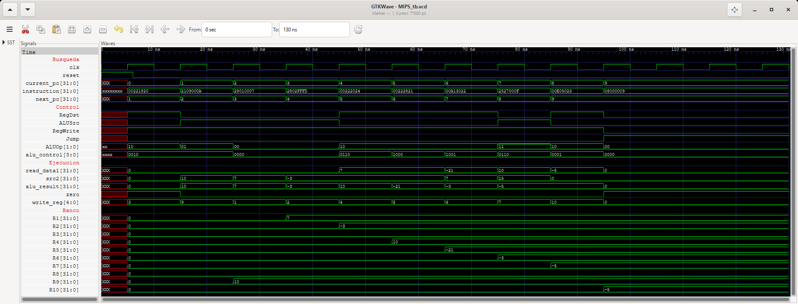

# 08 — Procesador MIPS completo (datapath monociclo)

**Fase 4 · Integración** · Estado: ✅ implementado y verificado (reset, 12/12 ciclos y 32/32 registros OK) ·
falta `consola.png`

## Objetivo
Conectar los seis módulos en un procesador que ejecute el programa de la IMEM de principio a fin: una
instrucción por ciclo, con el resultado guardado en el banco de registros y el siguiente PC elegido entre
`PC + 1` y la dirección del salto.

| Archivo | Contenido |
|---|---|
| `MIPS.v` | Módulo superior `MIPS`: seis instancias y la interconexión, toda con `assign` |
| `MIPS_tb.v` | Testbench `MIPS_tb`: reset, 12 ciclos comprobados señal por señal y estado final de los 32 registros |
| `MIPS_tb.gtkw` | Vista guardada de GTKWave: búsqueda, control, ejecución y registros `$1`–`$10` |
| `gtkwave.png` | Captura de GTKWave |

Reutiliza, sin copiarlos ni modificarlos, `../01_PC/PC.v`, `../02_IMEM/IMEM.v`,
`../04_ControlUnit/ControlUnit.v`, `../05_ALU/ALU.v`, `../06_ALUControl/ALUControl.v` y
`../07_RegisterFile/RegisterFile.v`.

## Puertos

| Puerto | Dirección | Ancho | Descripción |
|---|---|---|---|
| `clk` | input | 1 | Reloj del PC y del banco de registros |
| `reset` | input | 1 | Reinicio síncrono, activo en alto: `PC = 0` y los 32 registros en `0` |
| `current_pc` | output | 32 | Dirección de la instrucción en ejecución |
| `instruction` | output | 32 | Instrucción en ejecución |
| `alu_result` | output | 32 | Resultado de la ALU: se escribe en el banco si `RegWrite = 1` |

Las salidas permiten observar el procesador desde fuera. Las señales internas (control, operandos, destino,
siguiente PC) se leen en el testbench con una referencia jerárquica: `uut.RegDst`, `uut.src2`, etc.

## Conexión

```
BÚSQUEDA        pc_reg ── current_pc ──► imem ──► instruction
                                                   ├─ opcode    [31:26] ──► cu
                                                   ├─ rs        [25:21] ──► rf.read_reg1
                                                   ├─ rt        [20:16] ──► rf.read_reg2 y mux RegDst
                                                   ├─ rd        [15:11] ──► mux RegDst
                                                   ├─ funct     [5:0]   ──► aluc
                                                   ├─ immediate [15:0]  ──► extensión de signo
                                                   └─ address   [25:0]  ──► mux Jump

DECODIFICACIÓN  cu   : opcode ──► RegDst, ALUSrc, RegWrite, Jump, ALUOp
                aluc : ALUOp + funct ──► alu_control
                rf   : rs, rt ──► read_data1 ($rs), read_data2 ($rt)
                imm_ext = {{16{immediate[15]}}, immediate}

EJECUCIÓN       src2 = ALUSrc ? imm_ext : read_data2
                alu  : read_data1, src2, alu_control ──► alu_result, zero

ESCRITURA       write_reg  = RegDst ? rd : rt
                write_data = alu_result          → rf lo guarda en el flanco ↑ si RegWrite = 1

SIGUIENTE PC    pc_plus1 = current_pc + 1
                next_pc  = Jump ? {6'b000000, address} : pc_plus1   → pc_reg lo carga en el flanco ↑
```

### Instancias

| Instancia | Módulo | Entradas | Salidas |
|---|---|---|---|
| `pc_reg` | `PC` | `clk`, `reset`, `next_pc` | `current_pc` |
| `imem` | `IMEM` | `current_pc` | `instruction` |
| `cu` | `ControlUnit` | `opcode` | `RegDst`, `ALUSrc`, `RegWrite`, `Jump`, `ALUOp` |
| `aluc` | `ALUControl` | `ALUOp`, `funct` | `alu_control` |
| `rf` | `RegisterFile` | `clk`, `reset`, `RegWrite`, `rs`, `rt`, `write_reg`, `write_data` | `read_data1`, `read_data2` |
| `alu` | `ALU` | `read_data1`, `src2`, `alu_control` | `alu_result`, `zero` |

### Interconexión: solo `assign`

| Pieza | `assign` | Ancho | Por qué así |
|---|---|:---:|---|
| Campos | `opcode = instruction[31:26]`, `rs = [25:21]`, `rt = [20:16]`, `rd = [15:11]`, `funct = [5:0]`, `immediate = [15:0]`, `address = [25:0]` | — | Se cortan todos; cada módulo o mux toma el que le corresponde. `shamt` no se usa |
| Extensión de signo | `imm_ext = {{16{immediate[15]}}, immediate}` | 16 → 32 | D7: la ALU es con signo; `movi $2, -3` exige `0xFFFFFFFD` |
| Mux `RegDst` | `write_reg = RegDst ? rd : rt` | 5 | Las R escriben en `rd`; las I, en `rt` |
| Mux `ALUSrc` | `src2 = ALUSrc ? imm_ext : read_data2` | 32 | El segundo operando es un registro (R) o el inmediato (I) |
| Write-back | `write_data = alu_result` | 32 | Sin memoria de datos no hace falta el mux `MemtoReg` |
| Sumador | `pc_plus1 = current_pc + 32'd1` | 32 | D6: direccionamiento por palabra |
| Mux `Jump` | `next_pc = Jump ? {6'b000000, address} : pc_plus1` | 32 | D8: dirección de palabra directa, completada con ceros |

## Decisiones de diseño

1. **La interconexión es solo `assign`.** Son piezas combinacionales sin estado: un `assign` por pieza se lee
   igual que la ecuación del datapath ([Arquitectura §5.8](../docs/Arquitectura.md#s5-8)) y no hace falta un
   módulo con su propio testbench para un mux de dos entradas. `MIPS.v` no tiene ningún `always`: todo el
   comportamiento secuencial está dentro del PC y del banco.
2. **Los módulos no se tocan.** Se compilan desde su carpeta; el datapath usa exactamente el código verificado
   en las entregas 1 a 3.
3. **Mismo `clk` y `reset` para el PC y el banco.** Los dos son síncronos y se actualizan en el mismo flanco.
   Con `<=` el banco guarda el resultado de la instrucción que termina, no el de la siguiente
   ([Arquitectura §6.2](../docs/Arquitectura.md#s6)).
4. **Nombres de instancia cortos.** `rf` permite leer el arreglo del banco desde el testbench con
   `uut.rf.registers[i]`.
5. **`zero` queda sin usar.** Ninguna instrucción de esta ISA la consulta; está conectada a un `wire` para un
   futuro `beq`.

### Hallazgo: antes del primer flanco `RegWrite` vale `x`, no `0`
Un `always @(*)` solo se ejecuta cuando cambia una de sus entradas. Antes del primer flanco el `opcode` vale
`x` desde el instante 0 y no cambia hasta que el reset pone el PC en 0 (5 ns), así que los `always` de
ControlUnit, ALUControl y ALU todavía no se han ejecutado y sus salidas conservan el valor inicial `x`. En
GTKWave se ven en rojo de 0 a 5 ns. No hay riesgo: en ese primer flanco `reset = 1` y **el reset del banco
tiene prioridad sobre `RegWrite`**, así que no hay escrituras espurias. El testbench lo comprueba a los 6 ns
(PC en 0 y los 32 registros en 0).

Cuando el `opcode` sí cambia a `x` (por ejemplo, si el PC llega a una palabra vacía de la IMEM), la ControlUnit
cae en su `default` y pone `RegWrite = 0`: es lo que muestra la mutación 4 de abajo.

## Temporización

| t | Evento |
|---|---|
| 0–5 ns | Todo en `x`: el PC no se ha reiniciado, la IMEM lee `memory[x]` y el control aún no se evalúa |
| 5 ns | Primer flanco ↑ con `reset = 1`: `PC = 0` y los 32 registros en `0` |
| 6 ns | Se suelta `reset` y se comprueba el estado tras el reset |
| 10 + 10·k ns | Flanco ↓: se comparan las señales del ciclo k (toda la lógica combinacional ya se asentó) |
| 15 + 10·k ns | Flanco ↑: el banco guarda el resultado del ciclo k y el PC carga `next_pc` |
| 16 + 10·k ns | Se comprueba el registro escrito |
| 100–126 ns | Ciclos 9–11: `j 9` deja el PC en 9 y no escribe |
| 126 ns | Se comparan los 32 registros con el estado final esperado |
| 130 ns | `$finish` |

## Testbench (`MIPS_tb.v`)
- Tarea `ciclo_cpu(pc, instr, ctl, alu_control, src1, src2, result, write_reg, next_pc, caso)`, en dos tiempos:
  1. **Flanco ↓:** compara con `===` el PC, la instrucción, las cinco señales de control
     (`RegDst_ALUSrc_RegWrite_Jump_ALUOp`), `alu_control`, `src1` (`read_data1`), `src2`, `result`, `zero`
     (esperado: `result == 0`), `write_reg` y `next_pc`. Imprime una línea con todos los valores obtenidos.
  2. **1 ns después del flanco ↑:** si la instrucción escribe, compara `uut.rf.registers[write_reg]` con el
     `result` esperado. Imprime una segunda línea con la escritura, `OK`/`ERROR` y el mnemónico.
- Si algo no coincide, imprime los valores esperados debajo.
- **Lo esperado se escribe a mano**, con la traza de [Arquitectura §7](../docs/Arquitectura.md#s7); nada se lee
  del propio procesador. Los negativos se escriben en decimal (`-21` queda como `0xFFFFFFEB`).
- En `j 9` también se comparan los valores que nadie usa (`result = 0`, `write_reg = 0`): la traza los fija y
  un cambio en ellos delata un mux mal conectado (mutación 3).
- `revisar_reset` (6 ns) y `revisar_banco` (126 ns) recorren los 32 registros. La segunda imprime `$0`–`$10`,
  cuenta cuántos de `$11`–`$31` valen 0 y muestra una línea `ERROR` por cada registro distinto.
- `R1` a `R10` son `wire` conectados a `uut.rf.registers[i]`: `$dumpvars` no vuelca arreglos, y así los
  registros se ven en GTKWave.
- `$dumpfile("MIPS_tb.vcd")` y `$dumpvars(0, MIPS_tb)` (incluye las señales internas de `uut`).

## Casos de prueba (resultados de la simulación)

Señales en el orden `RegDst ALUSrc RegWrite Jump ALUOp`. Todos los valores esperados se calcularon a mano antes
de simular; los obtenidos son los de la consola.

| Ciclo | PC | Instrucción | Señales | `alu_control` | `src1` | `src2` | `result` | `zero` | `write_reg` | `next_pc` | Escritura esperada | Escritura obtenida | ¿OK? |
|:---:|:---:|---|:---:|:---:|---:|---:|---:|:---:|:---:|:---:|---|---|:---:|
| reset | 0 | — | — | — | — | — | — | — | — | — | 32 registros en 0 | 32 de 32 en 0 | ✅ |
| 0 | 0 | `add $3, $1, $2` | `1 0 1 0 10` | `0010` | 0 | 0 | 0 | 1 | 3 | 1 | `$3 = 0` | `$3 = 0` | ✅ |
| 1 | 1 | `addi $9, $8, 10` | `0 1 1 0 01` | `0010` | 0 | 10 | 10 | 0 | 9 | 2 | `$9 = 10` | `$9 = 10` | ✅ |
| 2 | 2 | `movi $1, 7` | `0 1 1 0 00` | `0000` | 0 | 7 | 7 | 0 | 1 | 3 | `$1 = 7` | `$1 = 7` | ✅ |
| 3 | 3 | `movi $2, -3` | `0 1 1 0 00` | `0000` | 0 | −3 | −3 | 0 | 2 | 4 | `$2 = −3` | `$2 = −3` | ✅ |
| 4 | 4 | `sub $4, $1, $2` | `1 0 1 0 10` | `0110` | 7 | −3 | 10 | 0 | 4 | 5 | `$4 = 10` | `$4 = 10` | ✅ |
| 5 | 5 | `mul $5, $1, $2` | `1 0 1 0 10` | `1000` | 7 | −3 | −21 | 0 | 5 | 6 | `$5 = −21` | `$5 = −21` | ✅ |
| 6 | 6 | `div $6, $5, $1` | `1 0 1 0 10` | `1001` | −21 | 7 | −3 | 0 | 6 | 7 | `$6 = −3` | `$6 = −3` | ✅ |
| 7 | 7 | `subi $7, $9, 15` | `0 1 1 0 11` | `0110` | 10 | 15 | −5 | 0 | 7 | 8 | `$7 = −5` | `$7 = −5` | ✅ |
| 8 | 8 | `mov $10, $7` | `1 0 1 0 10` | `0001` | −5 | 0 | −5 | 0 | 10 | 9 | `$10 = −5` | `$10 = −5` | ✅ |
| 9 | 9 | `j 9` | `0 0 0 1 00` | `0000` | 0 | 0 | 0 | 1 | 0 | **9** | ninguna | ninguna | ✅ |
| 10 | 9 | `j 9` | `0 0 0 1 00` | `0000` | 0 | 0 | 0 | 1 | 0 | 9 | ninguna | ninguna | ✅ |
| 11 | 9 | `j 9` | `0 0 0 1 00` | `0000` | 0 | 0 | 0 | 1 | 0 | 9 | ninguna | ninguna | ✅ |

- En el ciclo 0, `$1` y `$2` todavía valen 0 por el reset: reciben su valor en los ciclos 2 y 3. Por eso
  `add $3, $1, $2` da 0.
- MOVI lee `$0` por `rs` y MOV lee `$0` por `rt` (los campos sin usar van en 0): el mux `ALUSrc` y la ALU
  descartan esos valores.
- En `j 9` la ALU calcula `src2 = 0` (`alu_control = 0000`), pero `RegWrite = 0` protege el banco.

### Estado final del banco (126 ns)

| Registro | `$0` | `$1` | `$2` | `$3` | `$4` | `$5` | `$6` | `$7` | `$8` | `$9` | `$10` | `$11`–`$31` |
|---|:---:|:---:|:---:|:---:|:---:|:---:|:---:|:---:|:---:|:---:|:---:|:---:|
| Esperado | 0 | 7 | −3 | 0 | 10 | −21 | −3 | −5 | 0 | 10 | −5 | 0 |
| Obtenido | 0 | 7 | −3 | 0 | 10 | −21 | −3 | −5 | 0 | 10 | −5 | 0 (21 de 21) |

**Total: reset, 12 ciclos y 32 registros, 0 errores.** Compila sin advertencias con `iverilog -Wall`.

### Salida de la consola
```
=== Testbench MIPS: procesador completo ===
t=  1 ns  antes del primer flanco: PC=x, Instr=xxxxxxxx, RegWrite=x, Jump=x (x: aun no hay reset)
t=  6 ns  tras el flanco con reset: PC=0, 32 de 32 registros en 0       OK
ciclo  0  t= 10 ns  PC=0  Instr=00221820  ctl=1_0_1_0_10  alu_control=0010  src1=  0 src2=  0 -> result=  0 zero=1  write_reg= 3  next_pc=1
                    t= 16 ns  banco: $3 = 0    OK     add  $3, $1, $2
ciclo  1  t= 20 ns  PC=1  Instr=2109000a  ctl=0_1_1_0_01  alu_control=0010  src1=  0 src2= 10 -> result= 10 zero=0  write_reg= 9  next_pc=2
                    t= 26 ns  banco: $9 = 10    OK     addi $9, $8, 10
ciclo  2  t= 30 ns  PC=2  Instr=28010007  ctl=0_1_1_0_00  alu_control=0000  src1=  0 src2=  7 -> result=  7 zero=0  write_reg= 1  next_pc=3
                    t= 36 ns  banco: $1 = 7    OK     movi $1, 7
ciclo  3  t= 40 ns  PC=3  Instr=2802fffd  ctl=0_1_1_0_00  alu_control=0000  src1=  0 src2= -3 -> result= -3 zero=0  write_reg= 2  next_pc=4
                    t= 46 ns  banco: $2 = -3    OK     movi $2, -3
ciclo  4  t= 50 ns  PC=4  Instr=00222024  ctl=1_0_1_0_10  alu_control=0110  src1=  7 src2= -3 -> result= 10 zero=0  write_reg= 4  next_pc=5
                    t= 56 ns  banco: $4 = 10    OK     sub  $4, $1, $2
ciclo  5  t= 60 ns  PC=5  Instr=00222821  ctl=1_0_1_0_10  alu_control=1000  src1=  7 src2= -3 -> result=-21 zero=0  write_reg= 5  next_pc=6
                    t= 66 ns  banco: $5 = -21    OK     mul  $5, $1, $2
ciclo  6  t= 70 ns  PC=6  Instr=00a13022  ctl=1_0_1_0_10  alu_control=1001  src1=-21 src2=  7 -> result= -3 zero=0  write_reg= 6  next_pc=7
                    t= 76 ns  banco: $6 = -3    OK     div  $6, $5, $1
ciclo  7  t= 80 ns  PC=7  Instr=2527000f  ctl=0_1_1_0_11  alu_control=0110  src1= 10 src2= 15 -> result= -5 zero=0  write_reg= 7  next_pc=8
                    t= 86 ns  banco: $7 = -5    OK     subi $7, $9, 15
ciclo  8  t= 90 ns  PC=8  Instr=00e05023  ctl=1_0_1_0_10  alu_control=0001  src1= -5 src2=  0 -> result= -5 zero=0  write_reg=10  next_pc=9
                    t= 96 ns  banco: $10 = -5    OK     mov  $10, $7
ciclo  9  t=100 ns  PC=9  Instr=08000009  ctl=0_0_0_1_00  alu_control=0000  src1=  0 src2=  0 -> result=  0 zero=1  write_reg= 0  next_pc=9
                    t=106 ns  banco: sin escritura (RegWrite = 0)    OK     j    9
ciclo 10  t=110 ns  PC=9  Instr=08000009  ctl=0_0_0_1_00  alu_control=0000  src1=  0 src2=  0 -> result=  0 zero=1  write_reg= 0  next_pc=9
                    t=116 ns  banco: sin escritura (RegWrite = 0)    OK     j    9 (repite)
ciclo 11  t=120 ns  PC=9  Instr=08000009  ctl=0_0_0_1_00  alu_control=0000  src1=  0 src2=  0 -> result=  0 zero=1  write_reg= 0  next_pc=9
                    t=126 ns  banco: sin escritura (RegWrite = 0)    OK     j    9 (repite)
=== Estado final del banco (t=126 ns) ===
$0=0  $1=7  $2=-3  $3=0  $4=10  $5=-21  $6=-3  $7=-5  $8=0  $9=10  $10=-5  |  $11-$31: 21 de 21 en 0
32 de 32 registros como se esperaba       OK
=== Reset, 12 ciclos y estado final: todas las pruebas OK ===
MIPS_tb.v:238: $finish called at 130000 (1ps)
```

## El testbench detecta los errores de conexión
Se simularon cinco copias de `MIPS.v`, cada una con un solo `assign` o conexión cambiada. Todas terminan en
`ERROR`:

| # | Cambio | Qué se ve | Errores |
|:---:|---|---|:---:|
| 1 | Extensión con ceros: `imm_ext = {16'b0, immediate}` | `movi $2, -3` carga `65533`, y lo arrastran `sub`, `mul` y `div`: `$4 = -65526`, `$5 = 458731`, `$6 = 65533` | 8 (4 ciclos + 4 registros) |
| 2 | Mux `RegDst` invertido: `RegDst ? rt : rd` | `add $3, $1, $2` escribe en `$2`. Las I escriben en los bits 15:11 del inmediato: `addi` va a `$0` (se pierde) y `movi $2, -3` a `$31` | 18 (9 ciclos + 9 registros) |
| 3 | Mux `ALUSrc` invertido: `ALUSrc ? read_data2 : imm_ext` | `add` suma los bits bajos de la instrucción (`0x1820 = 6176`); las I usan `$rt` en vez del inmediato (`movi $1, 7` carga 0); en `j 9`, `result = 9` | 21 (12 ciclos + 9 registros) |
| 4 | Sin mux `Jump`: `next_pc = pc_plus1` | `j 9` da `next_pc = 10` y en los ciclos 10–11 el PC lee palabras vacías (`x`). **El estado final coincide**: con `opcode = x` la ControlUnit no escribe. Solo la comparación por ciclo lo detecta | 3 |
| 5 | Banco sin reset: `.reset(1'b0)` | Tras el reset solo `$0` vale 0; `add` calcula `x + x`, `addi $9, $8, 10` escribe `x`, y `subi` y `mov` lo arrastran | 31 (reset + 4 ciclos + 26 registros) |

Las mutaciones 1, 2 y 5 son los riesgos de [Arquitectura §11.3](../docs/Arquitectura.md#s11). La 4 muestra por
qué no basta con revisar el estado final.

## Capturas
- `consola.png` ⏳: desde esta carpeta, con **los dos comandos visibles** (`iverilog` y `vvp`), las dos líneas
  por ciclo y el estado final.
- [`gtkwave.png`](gtkwave.png) ✅: `MIPS_tb.gtkw` abre cuatro grupos. **Búsqueda:** `clk`, `reset`,
  `current_pc` y `next_pc` en decimal, `instruction` en hex. **Control:** las cinco señales y `alu_control` en
  binario. **Ejecución:** `read_data1`, `src2` y `alu_result` en decimal con signo, `zero` y `write_reg`.
  **Banco:** `R1`–`R10` en decimal con signo. Ventana de 1900 px y *Zoom Fit* (0–130 ns). Cada registro cambia
  en el flanco ↑ que termina su instrucción, a la vez que el PC avanza. De 0 a 5 ns las señales están en `x`
  (en rojo), como explica el hallazgo de arriba.



## Comandos
Ejecutar desde `08_MIPS/`:
```powershell
iverilog -Wall -o MIPS_tb.vvp ../01_PC/PC.v ../02_IMEM/IMEM.v ../04_ControlUnit/ControlUnit.v ../05_ALU/ALU.v ../06_ALUControl/ALUControl.v ../07_RegisterFile/RegisterFile.v MIPS.v MIPS_tb.v
vvp MIPS_tb.vvp
gtkwave MIPS_tb.vcd MIPS_tb.gtkw    # abre ya los cuatro grupos con su formato; luego View → Zoom Fit
```
`-Wall` activa todas las advertencias: la compilación no imprime ninguna.
