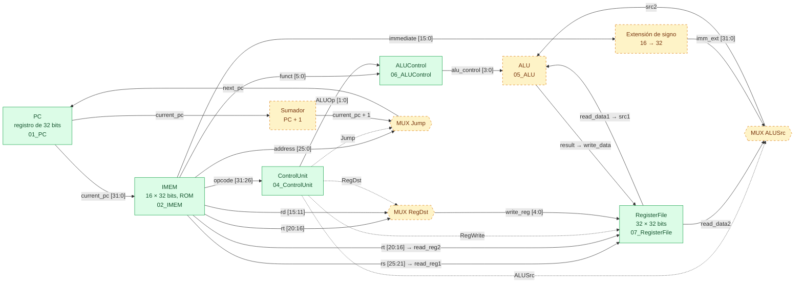

<a id="arquitectura"></a>

# Arquitectura del procesador MIPS de 32 bits

> **Documento técnico de referencia de la Práctica 1.** Explica qué hace cada parte del código, **por qué está
> hecha así** y cómo encaja en la arquitectura completa de un procesador de 32 bits.
>
> **Estado descrito:** 28/10/2026, commit `441014f`. Todos los testbenches se volvieron a simular con Icarus
> Verilog 14 al redactar este documento.

**Cómo leerlo:** las secciones 1 y 2 dan los fundamentos; la 3 define la ISA; la 4 presenta la arquitectura
completa; la 5 recorre el código módulo por módulo; la 6 explica la temporización; la 7 sigue el programa ciclo a
ciclo; de la 8 a la 10 se cubren la verificación, Verilog y las decisiones; la 11 analiza el estado del proyecto y
la 12, sus límites.

## Índice

1. [Resumen](#s1)
2. [Fundamentos: qué es un procesador de 32 bits](#s2)
3. [El conjunto de instrucciones (ISA)](#s3)
4. [Arquitectura global: el datapath monociclo](#s4)
5. [Módulo por módulo](#s5)
   - [5.1 PC](#s5-1) · [5.2 IMEM](#s5-2) · [5.3 PC + IMEM](#s5-3) · [5.4 ControlUnit](#s5-4) ·
     [5.5 ALUControl](#s5-5) · [5.6 ALU](#s5-6) · [5.7 RegisterFile](#s5-7) ·
     [5.8 Piezas pendientes del datapath](#s5-8)
6. [Temporización: anatomía de un ciclo](#s6)
7. [Ejecución completa del programa](#s7)
8. [Metodología de verificación](#s8)
9. [Idiomas de Verilog usados y por qué](#s9)
10. [Registro de decisiones de diseño](#s10)
11. [Estado actual del proyecto y hallazgos](#s11)
12. [Limitaciones y extensiones](#s12)
13. [Glosario](#s13)
14. [Referencias](#s14)

---

<a id="s1"></a>

## 1. Resumen

El proyecto construye, módulo por módulo, un **procesador MIPS simplificado de 32 bits** en Verilog. Sus rasgos
principales son:

| Rasgo | Valor | Consecuencia |
| :--- | :--- | :--- |
| Ancho de palabra | **32 bits**: registros, ALU, instrucciones y PC | Los valores dan la vuelta módulo 2³² |
| Microarquitectura | **Monociclo**: una instrucción por ciclo de reloj (CPI = 1) | La unidad de control es combinacional, sin máquina de estados |
| Organización de memoria | **Harvard**: memoria de instrucciones propia (IMEM); no hay memoria de datos | No hay `lw`/`sw`; los datos viven solo en los registros |
| ISA | **9 instrucciones** en 3 formatos: 5 R, 3 I y 1 J | Control pequeño: 5 opcodes y 5 `funct` |
| Direccionamiento | **Por palabra**: el PC avanza `+1` | El salto usa la dirección de palabra directa |
| Aritmética | **Con signo** (complemento a 2) e inmediato con extensión de signo | La división se hace con `$signed` |

### Estado de los módulos

| Módulo | Carpeta | Lógica | Estado | Verificación (resimulada) |
| :--- | :--- | :--- | :---: | :--- |
| PC | [`01_PC`](../01_PC/) | Secuencial | ✅ | 10 ciclos, 12 comprobaciones, 0 errores |
| IMEM | [`02_IMEM`](../02_IMEM/) | Combinacional (ROM) | ✅ | 18 lecturas, 0 errores |
| PC + IMEM | [`03_PC_IMEM`](../03_PC_IMEM/) | Integración | ✅ | 10 ciclos, 0 errores |
| ControlUnit | [`04_ControlUnit`](../04_ControlUnit/) | Combinacional | ✅ | 12 pruebas, 0 errores |
| ALU | [`05_ALU`](../05_ALU/) | Combinacional | ⏳ marcador vacío | — |
| ALUControl | [`06_ALUControl`](../06_ALUControl/) | Combinacional | ✅ | 15 pruebas, 0 errores |
| RegisterFile | [`07_RegisterFile`](../07_RegisterFile/) | Lectura combinacional, escritura secuencial | ✅ | 85 comprobaciones, 0 errores |
| Extensión de signo, muxes, siguiente PC, módulo superior | — | Combinacional | ⏳ Fase 4 | — |

---

<a id="s2"></a>

## 2. Fundamentos: qué es un procesador de 32 bits

### 2.1 Qué significa «32 bits»

Cuando se dice que un procesador «es de N bits», se habla sobre todo del **ancho de su datapath**: cuántos bits
caben en un registro y cuántos procesa la ALU en una operación. En este diseño, además, son de 32 bits las
instrucciones y las direcciones.

| Elemento | Ancho | Dónde aparece | Por qué ese ancho |
| :--- | :---: | :--- | :--- |
| Palabra de datos | 32 | `write_data`, `read_data1/2`, `result` | Es la unidad natural de cálculo: un `int` de C |
| Registros | 32 × 32 bits | `reg [31:0] registers [0:31]` | Cada registro guarda una palabra; 32 registros se direccionan con 5 bits |
| ALU | 32 | `src1`, `src2`, `result` | Opera una palabra completa en un solo paso |
| Instrucción | 32, longitud fija | `reg [31:0] memory [0:15]` | Una lectura de la IMEM es una instrucción completa |
| PC (dirección) | 32 | `current_pc`, `next_pc` | Espacio de 2³² direcciones, aunque la IMEM solo implementa 16 |
| Campos internos | 5 / 6 / 16 / 26 | `rs`, `opcode`, `immediate`, `address` | Reparto de los 32 bits de la instrucción (sección 3.2) |

**Consecuencias aritméticas del ancho fijo:**

- Rango sin signo: 0 a 2³² − 1 (4 294 967 295). Rango con signo: −2³¹ a 2³¹ − 1.
- Toda operación se calcula **módulo 2³²**: `0xFFFFFFFF + 1 = 0` y `65536 × 65536 = 2³² → 0`. No hay
  excepción por desbordamiento; el resultado simplemente da la vuelta.

### 2.2 ISA frente a microarquitectura

Conviene separar dos niveles, porque las decisiones del proyecto pertenecen a uno u otro:

| Nivel | Qué define | En este proyecto | ¿Lo ve el programador? |
| :--- | :--- | :--- | :---: |
| **ISA** (arquitectura del repertorio) | Instrucciones, formatos, opcodes, `funct`, registros, semántica | Sección 3: las 9 instrucciones y sus codificaciones | Sí |
| **Microarquitectura** | Cómo se implementa la ISA: módulos, señales, ciclos | Secciones 4 a 6: monociclo, `ALUOp`, `alu_control`, muxes | No |

Por ejemplo, los códigos `funct` son parte de la **ISA**: si cambian, hay que recodificar el programa de la
IMEM. En cambio, `ALUOp` y `alu_control` son **internos**: podrían cambiarse sin tocar ningún programa. Por eso
la decisión de los `funct` (D1) fue crítica y la de `ALUOp` (D2) es una cuestión de implementación.

### 2.3 RISC y la filosofía MIPS

MIPS es la arquitectura RISC de referencia en la enseñanza. Sus principios explican la mayoría de las decisiones
de este diseño:

| Principio | Cómo se refleja aquí |
| :--- | :--- |
| **Instrucciones de longitud fija** (32 bits) | La búsqueda es trivial: `next_pc = current_pc + 1` y una lectura de la IMEM es una instrucción |
| **Pocos formatos, con los campos en la misma posición** | `rs` siempre en `[25:21]` y `rt` siempre en `[20:16]`: el banco de registros lee los operandos **antes** de saber qué instrucción es (sección 3.2) |
| **Arquitectura registro-registro** (*load/store*) | La ALU solo opera con registros o inmediatos, nunca con la memoria |
| **Tres operandos** (`rd = rs op rt`) | El banco tiene 2 puertos de lectura y 1 de escritura |
| **Registro `$0` fijo en cero** | Da una constante gratis y permite descartar resultados (sección 5.7) |
| **Hardware simple y regular** | Control combinacional pequeño: un `case` sobre el opcode y otro sobre `funct` |

### 2.4 El ciclo de instrucción

Cada instrucción pasa por las mismas etapas lógicas. En un procesador **monociclo**, todas ocurren dentro de un
solo periodo de reloj, como una cadena combinacional entre dos flancos.

| Etapa | Qué hace | Módulos | Estado |
| :--- | :--- | :--- | :---: |
| **IF**: búsqueda | Lee la instrucción apuntada por el PC | PC, IMEM | ✅ (`03_PC_IMEM`) |
| **ID**: decodificación y lectura | Genera el control a partir del opcode y `funct`; lee `rs` y `rt`; extiende el inmediato | ControlUnit, ALUControl, RegisterFile, extensión de signo | ✅ salvo la extensión |
| **EX**: ejecución | Calcula el resultado | Mux `ALUSrc`, ALU | ⏳ |
| **MEM**: memoria | Lee o escribe datos (`lw`/`sw`) | — | No existe en esta ISA |
| **WB**: escritura | Guarda `result` en `write_reg` | Mux `RegDst`, RegisterFile | ✅ banco · ⏳ mux |
| **Siguiente PC** | Elige `PC + 1` o la dirección del salto | Sumador, mux `Jump` | ⏳ |

### 2.5 Monociclo, multiciclo y segmentado

| Microarquitectura | CPI | Periodo de reloj | Control | Complejidad |
| :--- | :---: | :--- | :--- | :--- |
| **Monociclo** (este proyecto) | 1 | Lo fija la instrucción **más lenta** | Combinacional | Mínima |
| Multiciclo | 3–5 | Lo fija la etapa más lenta | Máquina de estados | Media |
| Segmentado (*pipeline*) | ≈ 1 | Lo fija la etapa más lenta | Combinacional + detección de riesgos | Alta |

El tiempo de un programa es `N.º de instrucciones × CPI × T_reloj`. El monociclo tiene CPI = 1, pero **todas**
las instrucciones pagan el periodo de la más lenta. Aquí esa es la división (sección 6.5).

**Por qué monociclo:** es la forma más directa de estudiar el datapath. Cada módulo se prueba aislado, la unidad
de control es una simple tabla de verdad y un ciclo de simulación corresponde a una instrucción, lo que facilita
leer la consola y GTKWave. Las plantillas de entrega están pensadas así.

### 2.6 Datapath y control

Un procesador se divide en dos partes que se diseñan por separado:

- **Datapath:** los elementos que **guardan o transforman datos**: PC, IMEM, banco de registros, ALU, sumador,
  extensión de signo y multiplexores.
- **Control:** decide **qué hace el datapath** con cada instrucción: ControlUnit y ALUControl. Sus salidas son
  selectores de multiplexores (`RegDst`, `ALUSrc`, `Jump`), habilitaciones (`RegWrite`) y códigos de operación
  (`ALUOp` → `alu_control`).

En un monociclo, el control es una **función combinacional** de la instrucción actual: no recuerda nada de la
instrucción anterior.

### 2.7 Lógica combinacional y secuencial

| Tipo | Definición | En Verilog | Módulos |
| :--- | :--- | :--- | :--- |
| **Combinacional** | La salida depende solo de las entradas **actuales** | `assign` o `always @(*)` con `=` | IMEM (lectura), ControlUnit, ALUControl, ALU, lectura del banco, muxes, sumador |
| **Secuencial** | Guarda estado que cambia **solo en el flanco** del reloj | `always @(posedge clk)` con `<=` | PC, escritura del banco |

El procesador entero sigue un patrón síncrono: **estado → lógica combinacional → estado**. Solo hay dos
elementos con estado, el **PC** y el **banco de registros** (la IMEM es una ROM que se carga una vez). Ambos usan
el mismo reloj y el mismo flanco. Entre dos flancos, la lógica combinacional calcula a partir del estado actual el
siguiente PC y el valor que se escribirá; en el flanco, los dos se actualizan a la vez.

### 2.8 Números con signo: complemento a 2 y extensión de signo

**Complemento a 2.** Un número negativo `−n` se representa como `2³² − n`. Así, `−3 = 0xFFFFFFFD`. Lo importante
para el hardware es que **suma, resta y los 32 bits bajos de la multiplicación dan los mismos bits con o sin
signo**: el mismo circuito sirve para ambos. Solo cambian la **división** y las **comparaciones**. Comprobado en
Icarus 14:

| Operación | Bits de entrada | Sin signo | Con signo (`$signed`) |
| :--- | :--- | :--- | :--- |
| `7 × (−3)` | `0x7`, `0xFFFFFFFD` | `0xFFFFFFEB` | `0xFFFFFFEB` (= −21): **idénticos** |
| `−20 / 4` | `0xFFFFFFEC`, `0x4` | `1073741819` | `−5` |
| `−7 / 2` | `0xFFFFFFF9`, `0x2` | `2147483644` | `−3`: se trunca hacia cero |
| `INT_MIN / −1` | `0x80000000`, `0xFFFFFFFF` | `0` | `0x80000000`: desborda y da la vuelta |

**Extensión de signo.** Para operar un inmediato de 16 bits con un registro de 32, hay que ensancharlo. Se
replica el bit 15, el bit de signo, en los 16 bits altos: `{{16{imm[15]}}, imm}`.

| Inmediato (16 bits) | Valor | Extensión de signo (32) | Extensión con ceros (32) |
| :--- | :---: | :--- | :--- |
| `0x000A` | 10 | `0x0000000A` = 10 | `0x0000000A` = 10 |
| `0xFFFD` | −3 | `0xFFFFFFFD` = **−3** ✅ | `0x0000FFFD` = 65533 ❌ |

### 2.9 Direccionamiento por palabra frente a por byte

| | MIPS real | Este proyecto |
| :--- | :--- | :--- |
| Unidad de dirección | Byte | Palabra de 32 bits |
| Avance del PC | `PC + 4` | `PC + 1` |
| Dirección de salto | `{PC+4[31:28], address, 2'b00}` | `address` directa |
| Índice de la IMEM | `addr[…:2]` (se descartan los 2 bits bajos) | `addr[4:0]` |

La plantilla fija `siguiente = actual + 1`. Al direccionar por palabra, la dirección **es** el índice del arreglo
y no hay bits de alineación. La desventaja, no poder acceder a bytes ni medias palabras, no afecta porque no hay
memoria de datos.

### 2.10 Organización Harvard

Las instrucciones viven en su propia memoria, la IMEM, separada de los datos. En un monociclo con `lw`/`sw` esto
es **obligatorio**: en el mismo ciclo hay que leer la instrucción y acceder al dato, y una memoria de un solo
puerto no puede hacer las dos cosas. Aquí ni siquiera hay memoria de datos: los únicos datos son los registros y
los inmediatos.

---

<a id="s3"></a>

## 3. El conjunto de instrucciones (ISA)

### 3.1 Las nueve instrucciones

Opcodes de [`Tabla Opcode y Funct.xlsx`](Tabla%20Opcode%20y%20Funct.xlsx); códigos `funct` de la **tabla del
enunciado de ALUControl** (decisión D1).

| Instrucción | Tipo | Opcode | Funct | Operación | `ALUOp` | `alu_control` |
| :--- | :---: | :---: | :---: | :--- | :---: | :---: |
| **ADD** | R | `000000` | `100000` | `$rd = $rs + $rt` | `10` | `0010` |
| **SUB** | R | `000000` | `100100` | `$rd = $rs − $rt` | `10` | `0110` |
| **MUL** | R | `000000` | `100001` | `$rd = $rs × $rt` (32 bits bajos) | `10` | `1000` |
| **DIV** | R | `000000` | `100010` | `$rd = $rs / $rt` (con signo) | `10` | `1001` |
| **MOV** | R | `000000` | `100011` | `$rd = $rs` | `10` | `0001` |
| **MOVI** | I | `001010` | — | `$rt = signext(imm)` | `00` | `0000` |
| **ADDI** | I | `001000` | — | `$rt = $rs + signext(imm)` | `01` | `0010` |
| **SUBI** | I | `001001` | — | `$rt = $rs − signext(imm)` | `11` | `0110` |
| **JUMP** | J | `000010` | — | `PC = address` | `00` | irrelevante |

### 3.2 Formatos de instrucción

```
            31     26 25   21 20   16 15   11 10    6 5      0
 Tipo R    │ opcode  │  rs   │  rt   │  rd   │ shamt │ funct  │     add  $3, $1, $2
           │ 6 bits  │ 5     │ 5     │ 5     │ 5     │ 6      │
            31     26 25   21 20   16 15                     0
 Tipo I    │ opcode  │  rs   │  rt   │      immediate         │     addi $9, $8, 10
           │ 6 bits  │ 5     │ 5     │      16 bits           │
            31     26 25                                     0
 Tipo J    │ opcode  │              address                   │     j 9
           │ 6 bits  │              26 bits                   │
```

| Campo | Bits | Ancho | Uso |
| :--- | :---: | :---: | :--- |
| `opcode` | `[31:26]` | 6 | Tipo de instrucción; lo decodifica la ControlUnit |
| `rs` | `[25:21]` | 5 | Primer operando fuente → `read_reg1` |
| `rt` | `[20:16]` | 5 | Segundo operando en R; **destino** en I → `read_reg2` y mux `RegDst` |
| `rd` | `[15:11]` | 5 | Destino en R → mux `RegDst` |
| `shamt` | `[10:6]` | 5 | Desplazamiento; **no se usa** (siempre `0`) |
| `funct` | `[5:0]` | 6 | Operación concreta en R; lo decodifica ALUControl |
| `immediate` | `[15:0]` | 16 | Constante con signo en I → extensión de signo → mux `ALUSrc` |
| `address` | `[25:0]` | 26 | Dirección de palabra del salto → mux `Jump` |

**Por qué esos anchos:**

- `6 + 5 + 5 + 5 + 5 + 6 = 32`. Con 5 bits por registro hay 2⁵ = 32 registros. Más registros alargarían los
  campos y dejarían menos bits para el inmediato: es un compromiso.
- Las instrucciones R comparten el opcode `000000` y se distinguen por `funct`. Así se amplía el espacio de
  operaciones sin gastar opcodes: 64 opcodes y, además, 64 `funct`.
- **Regularidad:** `rs` y `rt` están siempre en la misma posición. Por eso el banco de registros puede leer los
  dos operandos en paralelo con la decodificación, sin esperar a saber el tipo de instrucción. El destino sí
  varía (`rd` en R, `rt` en I), y por eso existe el mux `RegDst`.
- En las instrucciones I y J, los bits que en R serían `rd`, `shamt` y `funct` pertenecen al inmediato o a la
  dirección. ALUControl los recibe igual como «`funct`» y debe **ignorarlos** (sección 5.5).

### 3.3 Semántica detallada

| Instrucción | Lee | Escribe | Detalle |
| :--- | :--- | :--- | :--- |
| ADD / SUB | `$rs`, `$rt` | `$rd` | Módulo 2³², sin detección de desbordamiento |
| MUL | `$rs`, `$rt` | `$rd` | Solo los **32 bits bajos** del producto de 64: `65536 × 65536 = 0` |
| DIV | `$rs`, `$rt` | `$rd` | Con signo, **se trunca hacia cero** (`−7 / 2 = −3`); entre cero da **0** (D4) |
| MOV | `$rs` | `$rd` | `rt` no se usa y se codifica como `00000` |
| MOVI | — | `$rt` | `rs` no se usa y se codifica como `00000`; inmediato con signo: −32768 a 32767 |
| ADDI / SUBI | `$rs` | `$rt` | Inmediato extendido con signo (D7) |
| JUMP | — | — | `PC = {6'b0, address}`: dirección de palabra directa (D8); no escribe registros |

### 3.4 Registros

32 registros de propósito general, `$0` a `$31`. La única convención de hardware es que **`$0` vale siempre 0**.
No hay convenciones de software (`$sp`, `$ra`, etc.) porque no hay llamadas a subrutinas ni pila. El programa
usa `$1` a `$10`.

### 3.5 Codificar una instrucción paso a paso

**`sub $4, $1, $2`** (tipo R, dirección 4 de la IMEM):

| Campo | opcode | rs | rt | rd | shamt | funct |
| :--- | :---: | :---: | :---: | :---: | :---: | :---: |
| Valor | R | `$1` | `$2` | `$4` | — | SUB |
| Binario | `000000` | `00001` | `00010` | `00100` | `00000` | `100100` |

`0000 0000 0010 0010 0010 0000 0010 0100` = **`0x00222024`**

**`movi $2, -3`** (tipo I, dirección 3):

| Campo | opcode | rs | rt | immediate |
| :--- | :---: | :---: | :---: | :---: |
| Valor | MOVI | sin usar | `$2` | −3 |
| Binario | `001010` | `00000` | `00010` | `1111111111111101` |

`0010 1000 0000 0010 1111 1111 1111 1101` = **`0x2802FFFD`**

### 3.6 Comparación con MIPS32 real

| Aspecto | MIPS32 real | Este proyecto |
| :--- | :--- | :--- |
| `funct` de SUB | `100010` | `100100` (en MIPS real es **AND**) |
| `funct` de MUL | `mult` = `011000`, escribe en HI/LO | `100001` (en MIPS real es **ADDU**) y escribe en `$rd` |
| `funct` de DIV | `div` = `011010`, escribe en HI/LO | `100010` (en MIPS real es **SUB**) y escribe en `$rd` |
| MOV | Pseudoinstrucción: `addu $rd, $rs, $zero` | Instrucción R, `funct` `100011` (en MIPS real es **SUBU**) |
| MOVI | Pseudoinstrucción `li`: `addiu $rt, $zero, imm` | Opcode `001010` (en MIPS real es **SLTI**) |
| ADDI | `001000`, provoca excepción si hay desbordamiento | `001000`, sin excepción: da la vuelta |
| SUBI | No existe: se usa `addi` con un inmediato negativo | Opcode `001001` (en MIPS real es **ADDIU**) |
| J | `{PC+4[31:28], address, 2'b00}` | `PC = address` (palabra) |
| Direccionamiento | Por byte, `PC + 4` | Por palabra, `PC + 1` |
| Memoria de datos y saltos condicionales | `lw`, `sw`, `beq`, `bne`, … | No hay |

**Observación importante:** los `funct` de la hoja `.xlsx` (SUB `100010`, MUL `011000`, DIV `011010`) **son los
de MIPS real**. Los de la tabla de ALUControl son propios del curso. Como el grupo adoptó estos últimos (D1),
**un ensamblador MIPS estándar (MARS, SPIM) no genera código válido para este procesador**: las instrucciones R
se codifican a mano, como en la IMEM.

---

<a id="s4"></a>

## 4. Arquitectura global: el datapath monociclo

### 4.1 Diagrama completo

Los bloques en verde existen y están verificados; los punteados en ámbar son de la Fase 4. Líneas continuas:
datos; líneas punteadas: señales de control.



El mismo datapath, en texto y por etapas:

```
BÚSQUEDA        PC ──current_pc──► IMEM ──► instruction[31:0]

DECODIFICACIÓN  opcode    ──► ControlUnit ──► RegDst, ALUSrc, RegWrite, Jump, ALUOp
                ALUOp + funct ──► ALUControl ──► alu_control
                rs, rt    ──► RegisterFile ──► read_data1, read_data2
                immediate ──► extensión de signo ──► imm_ext

EJECUCIÓN       src1 = read_data1
                src2 = ALUSrc ? imm_ext : read_data2
                ALU(src1, src2, alu_control) ──► result, zero

ESCRITURA       write_reg = RegDst ? rd : rt
                flanco ↑: si RegWrite = 1, registers[write_reg] <= result

SIGUIENTE PC    next_pc = Jump ? {6'b0, address} : current_pc + 1
                flanco ↑: current_pc <= next_pc
```

### 4.2 Inventario de componentes

| Componente | Función | Lógica | Anchos | Estado |
| :--- | :--- | :--- | :--- | :---: |
| PC | Guarda la dirección de la instrucción actual | Secuencial | 32 | ✅ |
| IMEM | ROM con el programa | Combinacional | addr 32 → instr 32 | ✅ |
| ControlUnit | Decodificador principal: opcode → señales | Combinacional | 6 → 1+1+1+1+2 | ✅ |
| ALUControl | Decodificador secundario: `ALUOp` + `funct` → operación | Combinacional | 2+6 → 4 | ✅ |
| RegisterFile | 32 registros, 2 lecturas y 1 escritura | Lectura comb. / escritura sec. | 5 → 32 | ✅ |
| ALU | Suma, resta, multiplicación, división y paso de operandos | Combinacional | 32+32+4 → 32+1 | ⏳ |
| Extensión de signo | `imm[15:0]` → 32 bits con signo | Combinacional | 16 → 32 | ⏳ |
| Mux `RegDst` | Destino: `rd` o `rt` | Combinacional | 5 | ⏳ |
| Mux `ALUSrc` | `src2`: `read_data2` o inmediato | Combinacional | 32 | ⏳ |
| Sumador `PC + 1` | Siguiente dirección secuencial | Combinacional | 32 | ⏳ (hoy está en el testbench de `03`) |
| Mux `Jump` | Siguiente PC: `PC + 1` o `address` | Combinacional | 32 | ⏳ |
| Módulo superior | Instancia y conecta todo | Estructural | — | ⏳ |

### 4.3 Señales de control

| Señal | Valor 0 | Valor 1 | Instrucciones con 1 |
| :--- | :--- | :--- | :--- |
| `RegDst` | `write_reg = rt` | `write_reg = rd` | R |
| `ALUSrc` | `src2 = read_data2` | `src2 = imm_ext` | MOVI, ADDI, SUBI |
| `RegWrite` | El banco no cambia | Escribe `result` en `write_reg` en el flanco ↑ | R, MOVI, ADDI, SUBI |
| `Jump` | `next_pc = PC + 1` | `next_pc = address` | JUMP |
| `ALUOp` | — | — | `00` MOVI/JUMP · `01` ADDI · `10` R · `11` SUBI |

### 4.4 Qué camino recorre cada tipo de instrucción

| Tipo | Operandos de la ALU | Operación | Destino | Siguiente PC |
| :--- | :--- | :--- | :--- | :--- |
| **R** (ADD…MOV) | `src1 = $rs`, `src2 = $rt` (`ALUSrc = 0`) | Según `funct` | `$rd` (`RegDst = 1`) | `PC + 1` |
| **MOVI** | `src2 = imm_ext` (`ALUSrc = 1`); `src1` se ignora | `0000`: deja pasar `src2` | `$rt` (`RegDst = 0`) | `PC + 1` |
| **ADDI / SUBI** | `src1 = $rs`, `src2 = imm_ext` | `0010` / `0110` | `$rt` | `PC + 1` |
| **JUMP** | Irrelevante | Irrelevante | Ninguno (`RegWrite = 0`) | `address` |
| **Opcode no definido** | Irrelevante | `0000` | Ninguno (`RegWrite = 0`) | `PC + 1`: se comporta como un `nop` |

Una instrucción correcta requiere que **varias señales cooperen**. Por ejemplo, MOVI necesita `ALUOp = 00`
(operación «pasar `src2`») **y** `ALUSrc = 1` (que `src2` sea el inmediato). Con `ALUSrc = 0`, MOVI copiaría
`$rt`, el valor viejo del propio destino.

### 4.5 Por qué el control tiene dos niveles

La ControlUnit solo mira el **opcode**. Como las cinco instrucciones R comparten el opcode `000000`, no puede
saber cuál es la operación; solo sabe que «es tipo R» (`ALUOp = 10`). ALUControl hace el segundo nivel: con
`ALUOp = 10` consulta `funct`; con cualquier otro valor, `ALUOp` ya determina la operación.

Es el esquema de Patterson & Hennessy y tiene ventajas concretas:

- **ControlUnit más pequeña:** decodifica 6 bits en lugar de 12.
- **Separación de responsabilidades:** añadir una operación R solo modifica ALUControl y la ALU.
- **Camino crítico más corto:** el decodificador principal no espera a `funct`.

### 4.6 Qué le falta respecto a un MIPS monociclo completo

| Elemento de MIPS | Para qué sirve | Por qué no está |
| :--- | :--- | :--- |
| Memoria de datos (DMEM) | `lw` / `sw` | La ISA no tiene accesos a memoria |
| `MemRead`, `MemWrite` | Controlan la DMEM | Ídem |
| `MemtoReg` + mux | Elige entre `result` y el dato leído | Siempre se escribe `result` |
| `Branch` + AND con `zero` | `beq` / `bne` | No hay saltos condicionales; la bandera `zero` queda **preparada** para ellos |
| HI/LO | Producto de 64 bits y resto | MUL se trunca y DIV descarta el resto |

---

<a id="s5"></a>

## 5. Módulo por módulo

Cada subsección sigue el mismo orden: papel en la arquitectura, interfaz, código explicado, decisiones con su
justificación y verificación.

<a id="s5-1"></a>

### 5.1 PC: Program Counter

**Papel.** Es el único registro de control del procesador: guarda **qué instrucción se ejecuta**. Todo ciclo
empieza en su salida.

| Puerto | Dir. | Ancho | Descripción |
| :--- | :---: | :---: | :--- |
| `clk` | in | 1 | Reloj |
| `reset` | in | 1 | Reinicio síncrono, activo en alto |
| `next_pc` | in | 32 | Dirección siguiente |
| `current_pc` | out reg | 32 | Dirección actual |

**Código** ([`PC.v:23-28`](../01_PC/PC.v#L23-L28)):

```verilog
always @(posedge clk) begin
    if (reset)
        current_pc <= 32'd0;
    else
        current_pc <= next_pc;
end
```

- `always @(posedge clk)`: el PC solo cambia en el flanco de subida. Durante el resto del ciclo su salida se
  mantiene **estable**, que es justo lo que necesita la IMEM para leer.
- `if (reset)` se evalúa **dentro** del flanco, así que el reset es **síncrono** y tiene prioridad sobre
  `next_pc`.
- `<=` (no bloqueante): todos los registros que comparten el flanco muestrean sus entradas **antes** de que
  cualquiera cambie (sección 6.2).

**Decisiones:**

| Decisión | Alternativa | Por qué |
| :--- | :--- | :--- |
| **Reset síncrono** | Asíncrono: `always @(posedge clk or posedge reset)` | Lo pide la plantilla («con reset = 1 vale 0 … en cada flanco positivo»). Además coincide con el banco de registros, así que **los dos se reinician en el mismo flanco**. Costo: `current_pc = x` hasta el primer flanco, y el testbench lo muestra |
| **Reiniciar a 0** | Un vector de arranque (MIPS real: `0xBFC00000`) | El programa empieza en la palabra 0 de la IMEM |
| **El PC no calcula su siguiente valor** | Integrar `+1` dentro del PC | Separación de responsabilidades: el PC es solo un registro. La lógica del siguiente PC (`+1`, salto y, en el futuro, `beq`) vive en el datapath y puede crecer sin tocar este módulo |
| **32 bits completos** aunque la IMEM use 5 | Un PC de 4 o 5 bits | El ancho del PC pertenece a la ISA (espacio de direcciones de 32 bits); el tamaño de la IMEM es un detalle de implementación. El caso 6 comprueba que `0xFFFFFFFF` se guarda sin truncar |

**Verificación** ([`PC_tb.v`](../01_PC/PC_tb.v)):

- Reloj de 10 ns. Las entradas cambian en el **flanco de bajada** y se comprueba **1 ns después del flanco de
  subida**, cuando el `<=` ya se asentó.
- La tarea `paso(reset, next_pc, esperado, caso)` encapsula un ciclo, y `verificar` compara con `!==`, así que una
  `x` cuenta como error.
- Casos: reset con `next_pc ≠ 0` (el reset gana), soltar reset, avance normal, `next_pc` cambiando **dos veces
  entre flancos** sin que el PC se mueva, reset a mitad de ejecución y 32 bits en 1.
- **Resultado: 10 ciclos y 12 comprobaciones, 0 errores.**

<a id="s5-2"></a>

### 5.2 IMEM: memoria de instrucciones

**Papel.** Es la ROM con el programa. Recibe una dirección de palabra y devuelve la instrucción de 32 bits.

| Puerto | Dir. | Ancho | Descripción |
| :--- | :---: | :---: | :--- |
| `addr` | in | 32 | Dirección (por palabra) |
| `instruction` | out | 32 | Instrucción leída |

**Código:**

```verilog
reg [31:0] memory [0:15];                     // IMEM.v:14 — 16 palabras de 32 bits
assign instruction = memory[addr[4:0]];       // IMEM.v:20 — lectura combinacional
initial begin                                 // IMEM.v:29-40 — programa precargado
    memory[0] = 32'b000000_00001_00010_00011_00000_100000; // R  add  $3, $1, $2
    ...
    memory[9] = 32'b000010_00000000000000000000001001;     // J  j    9
end
```

- **`assign` (lectura combinacional):** la instrucción cambia en cuanto cambia `addr`, sin esperar al reloj. En un
  monociclo es imprescindible: la instrucción tiene que estar disponible **en el mismo ciclo** en que el PC la
  apunta. Con una lectura síncrona llegaría un ciclo tarde, lo que ya sería una etapa de *pipeline*.
- **`initial`:** carga el programa en `t = 0`. Cada palabra está escrita en binario, con los campos separados por
  `_` según el formato, y lleva el mnemónico como comentario, tal como pide la plantilla.
- **`addr[4:0]`:** se indexa con los 5 bits bajos (decisión D5).

**Qué lee cada dirección:**

| `addr` | `addr[4:0]` | Lee | Por qué |
| :--- | :---: | :--- | :--- |
| 0–9 | 0–9 | El programa | Palabras escritas en el `initial` |
| 10–15 | 10–15 | `x` | Dentro del arreglo, pero nunca escritas |
| 16–31 | 16–31 | `x` | Índice fuera de `memory[0:15]`: Verilog devuelve `x` |
| 32 | 0 | La instrucción 0 | Los bits altos se ignoran |

**El programa** (decisión D13):

| Dir | Hex | Mnemónico | Formato | Por qué está ahí |
| :---: | :---: | :--- | :---: | :--- |
| 0 | `00221820` | `add $3, $1, $2` | R | La da el enunciado. Tras el reset da `0` |
| 1 | `2109000A` | `addi $9, $8, 10` | I | La da el enunciado. Carga `$9 = 10` para SUBI |
| 2 | `28010007` | `movi $1, 7` | I | Operando positivo |
| 3 | `2802FFFD` | `movi $2, -3` | I | Inmediato negativo: prueba la **extensión de signo** |
| 4 | `00222024` | `sub $4, $1, $2` | R | Resta de un negativo: `7 − (−3) = 10` |
| 5 | `00222821` | `mul $5, $1, $2` | R | Producto negativo: `−21` |
| 6 | `00A13022` | `div $6, $5, $1` | R | **División con signo**: `−21 / 7 = −3` (sin signo daría 613566753) |
| 7 | `2527000F` | `subi $7, $9, 15` | I | Resultado negativo a partir de positivos: `−5` |
| 8 | `00E05023` | `mov $10, $7` | R | Copia un negativo |
| 9 | `08000009` | `j 9` | J | **Salta a sí misma**: detiene el programa y congela los registros |

**Decisiones:**

| Decisión | Alternativa | Por qué |
| :--- | :--- | :--- |
| **`addr[4:0]`** (D5) | `addr[3:0]`: 16 vuelve a 0 | Lo pide el enunciado. Con `[3:0]` la dirección 16 leería la instrucción 0; el testbench lo detectaría (lectura 16) |
| **Palabras 10–15 en `x`** | Rellenarlas con `0` | La plantilla pregunta qué leen. La `x` se ve en rojo en GTKWave y delata que el PC salió del programa. Curiosidad: `0x00000000` sería inofensivo aquí (tipo R, `funct` no definido → resultado 0 → se escribe en `$0` → se descarta), igual que `sll $0,$0,0`, que es el `nop` de MIPS real |
| **Programa en un `initial`** | `$readmemb("prog.mem", memory)` | La plantilla pide el código pegado como texto con los mnemónicos comentados. `$readmemb` separaría el programa del módulo |
| **Campos sin usar en 0** (D10) | Dejar basura | Una codificación canónica: `shamt = 0` siempre, `rs = 0` en MOVI y `rt = 0` en MOV. Además, los puertos de lectura leen `$0` = 0, un valor conocido |

**Verificación** ([`IMEM_tb.v`](../02_IMEM/IMEM_tb.v)):

- Declara los campos como `wire` (`opcode = instruction[31:26]`, …) para que aparezcan en GTKWave.
- `leer(dirección, esperado, caso)` espera 10 ns (lectura combinacional) y compara con `!==`: una `x` esperada solo
  coincide con una `x` leída.
- Detecta el formato por el opcode (`000000` → R, `000010` → J, el resto → I) e imprime los campos según ese
  formato. El inmediato se muestra con `$signed`.
- **El esperado se escribe a mano**, no se lee de la memoria: un error de codificación en `IMEM.v` aparece como
  `ERROR`.
- **Resultado: 18 lecturas (0–16 y 32), 0 errores.**

<a id="s5-3"></a>

### 5.3 Integración PC + IMEM: la etapa de búsqueda

**Papel.** Cierra el primer lazo del procesador: `PC → IMEM` y `PC + 1 → PC`. Es la etapa IF completa, salvo el
salto.

**Código** ([`PC_IMEM_tb.v`](../03_PC_IMEM/PC_IMEM_tb.v)):

```verilog
assign next_pc = current_pc + 32'd1;                        // :22 — el PC avanza solo
PC   uut_pc   (.clk(clk), .reset(reset), .next_pc(next_pc), .current_pc(current_pc));   // :36-41
IMEM uut_imem (.addr(current_pc), .instruction(instruction));                           // :44-47
```

- **No hay módulo nuevo:** la plantilla pide calcular la dirección siguiente en el testbench. El sumador y el mux
  del salto se convertirán en hardware en la Fase 4.
- Se compilan `../01_PC/PC.v` y `../02_IMEM/IMEM.v` desde su carpeta original. **No se copian**, para que exista
  una sola fuente de verdad.

**Temporización del arranque** ([`PC_IMEM_tb.v:115-116`](../03_PC_IMEM/PC_IMEM_tb.v#L115-L116)):

| t | Evento |
| :--- | :--- |
| 0–5 ns | `PC = x`, `instruction = x` (reset síncrono, todavía sin flanco) |
| 5 ns | Primer flanco ↑ con `reset = 1` → `PC = 0` |
| 6 ns | Se suelta `reset`, **antes** del siguiente flanco, para que la instrucción 0 dure un ciclo completo |
| 10 + 10k ns | Flanco ↓: se imprime el ciclo k |
| 104 ns | `$finish`, antes del flanco de 105 ns que llevaría el PC a 10 (`x`) |

**Por qué se imprime en el flanco de bajada:** el PC cambia en el flanco de subida. Medio ciclo después, tanto el
PC como la salida combinacional de la IMEM están estables, sin carreras con el `<=`.

**El salto no se ejecuta:** aquí `next_pc` siempre vale `PC + 1`, así que `j 9` solo se lee y se decodifica.
Elegir con `Jump` es trabajo de la Fase 4.

**Verificación:** compara el PC y la instrucción de cada ciclo con valores escritos a mano. Se comprobó además
que con `+4` el testbench marca `ERROR` desde el ciclo 1. **Resultado: 10 ciclos, 0 errores.**

<a id="s5-4"></a>

### 5.4 ControlUnit: unidad de control principal

**Papel.** Traduce el opcode en las señales que configuran el datapath para esa instrucción. Es una tabla de
verdad hecha hardware.

| Puerto | Dir. | Ancho | Descripción |
| :--- | :---: | :---: | :--- |
| `opcode` | in | 6 | `instruction[31:26]` |
| `RegDst`, `ALUSrc`, `RegWrite`, `Jump` | out reg | 1 c/u | Sección 4.3 |
| `ALUOp` | out reg | 2 | Clase de operación para ALUControl |

**Tabla de verdad implementada** (D3):

| Tipo | Opcode | RegDst | ALUSrc | RegWrite | Jump | ALUOp |
| :--- | :---: | :---: | :---: | :---: | :---: | :---: |
| R | `000000` | 1 | 0 | 1 | 0 | `10` |
| MOVI | `001010` | 0 | 1 | 1 | 0 | `00` |
| ADDI | `001000` | 0 | 1 | 1 | 0 | `01` |
| SUBI | `001001` | 0 | 1 | 1 | 0 | `11` |
| JUMP | `000010` | 0 | 0 | **0** | 1 | `00` |
| No definido (o `x`/`z`) | otro | 0 | 0 | **0** | **0** | `00` |

**Código** ([`ControlUnit.v:21-82`](../04_ControlUnit/ControlUnit.v#L21-L82)):

```verilog
always @(*) begin
    RegDst = 1'b0; ALUSrc = 1'b0; RegWrite = 1'b0; Jump = 1'b0; ALUOp = 2'b00;   // :28-32 valores por defecto
    case (opcode)
        6'b000000: begin RegDst = 1'b1; RegWrite = 1'b1; ALUOp = 2'b10; end      // :40-44 tipo R
        6'b001010: begin ALUSrc = 1'b1; RegWrite = 1'b1; end                     // :48-51 MOVI
        6'b001000: begin ALUSrc = 1'b1; RegWrite = 1'b1; ALUOp = 2'b01; end      // :55-59 ADDI
        6'b001001: begin ALUSrc = 1'b1; RegWrite = 1'b1; ALUOp = 2'b11; end      // :63-67 SUBI
        6'b000010: begin Jump = 1'b1; end                                        // :72-74 JUMP
        default: ;                                                               // :79    no definido
    endcase
end
```

- **`always @(*)`**: la lista de sensibilidad automática reevalúa el bloque cada vez que cambia `opcode`. Las
  salidas son `output reg` solo porque se asignan dentro de un `always`; **no** son registros físicos.
- **Valores por defecto antes del `case`:** es la técnica clave. Si una rama no asignara una salida, Verilog
  tendría que «recordar» su valor anterior y se inferiría un **latch**. En simulación, la señal arrastraría el
  valor de la instrucción previa o valdría `x` si nunca se asignó. Con los valores por defecto, cada rama solo
  escribe lo que **difiere** del estado seguro.
- **`default: ;`** deja los valores por defecto. También atrapa los opcodes con `x` o `z`: el `case` de Verilog
  compara bit a bit los cuatro estados, así que `xxxxxx` no coincide con ninguna etiqueta formada por 0 y 1.
- **No mira `funct`:** las cinco instrucciones R reciben las mismas señales (sección 4.5).

**Decisiones:**

| Decisión | Alternativa | Por qué |
| :--- | :--- | :--- |
| **Ninguna salida en `x`** (D3) | Usar `x` como «no importa» en las celdas «—» del enunciado | Con valores concretos, el testbench compara las 5 señales con `!==` y en la Fase 4 no se propagan `x` por los muxes. Una `x` en `RegWrite` o `Jump` podría corromper el estado |
| **JUMP: `RegWrite = 0`** | Dejarlo indefinido | Un salto no produce un resultado. Si escribiera, guardaría basura en algún registro |
| **Opcode no definido → `0 0 0 0 00`** | Cualquier otra combinación | Es el estado **seguro**: no escribe ni salta, así que se comporta como un `nop`. Incluye el opcode `x` de las palabras vacías de la IMEM |
| **`ALUOp`: `01` ADDI, `11` SUBI** (D2) | Usar `00` para todas las I | El enunciado solo define `00` (MOVI) y `10` (R). Con `00`, ADDI y SUBI ejecutarían «pasar `src2`» y devolverían solo el inmediato. Así quedan definidos los 4 valores de `ALUOp` |

**Verificación** ([`ControlUnit_tb.v`](../04_ControlUnit/ControlUnit_tb.v)):

- `probar(opcode, esperado, caso)` compara el vector `{RegDst, ALUSrc, RegWrite, Jump, ALUOp}` de una vez con un
  esperado escrito como `6'b1_0_1_0_10`.
- Además de los 5 opcodes válidos y el caso no definido, prueba opcodes **a un bit** de JUMP (`000011`) y de MOVI
  (`001011`), un opcode **`x`** y la secuencia **R → J → SUBI**, en la que cambian las 5 señales. Así, un valor
  arrastrado de la instrucción anterior daría `ERROR`.
- **Prueba de mutación** (documentada en el README del módulo): sin el valor por defecto de `Jump` fallan 10
  pruebas, y con `ALUOp = 01` en SUBI fallan 2. El testbench detecta exactamente los errores que pretende
  prevenir.
- **Resultado: 12 pruebas, 0 errores.**

<a id="s5-5"></a>

### 5.5 ALUControl: control de la ALU

**Papel.** Es el segundo nivel de decodificación: convierte `ALUOp` y, en las instrucciones R, `funct` en el
código de 4 bits que selecciona la operación de la ALU.

**Tabla implementada:**

| `ALUOp` | `funct` | Instrucción | `alu_control` | Operación de la ALU |
| :---: | :---: | :--- | :---: | :--- |
| `00` | cualquiera | MOVI (y JUMP) | `0000` | `result = src2` |
| `01` | cualquiera | ADDI | `0010` | `src1 + src2` |
| `10` | `100000` | ADD | `0010` | `src1 + src2` |
| `10` | `100100` | SUB | `0110` | `src1 − src2` |
| `10` | `100001` | MUL | `1000` | `src1 × src2` |
| `10` | `100010` | DIV | `1001` | `src1 / src2` |
| `10` | `100011` | MOV | `0001` | `result = src1` |
| `10` | otro | no definido | `1111` | `result = 0` |
| `11` | cualquiera | SUBI | `0110` | `src1 − src2` |

**Código** ([`ALUControl.v:14-48`](../06_ALUControl/ALUControl.v#L14-L48)):

```verilog
always @(*) begin
    case (ALUOp)
        2'b00: alu_control = 4'b0000;                  // MOVI: funct se ignora
        2'b01: alu_control = 4'b0010;                  // ADDI: suma
        2'b10: case (funct)                            // tipo R: decodificar funct
                   6'b100000: alu_control = 4'b0010;   // ADD
                   6'b100100: alu_control = 4'b0110;   // SUB
                   6'b100001: alu_control = 4'b1000;   // MUL
                   6'b100010: alu_control = 4'b1001;   // DIV
                   6'b100011: alu_control = 4'b0001;   // MOV
                   default:   alu_control = 4'b1111;   // funct no definido
               endcase
        2'b11: alu_control = 4'b0110;                  // SUBI: resta
        default: alu_control = 4'b1111;                // ALUOp con x/z
    endcase
end
```

- **`case` anidado:** `funct` solo se consulta cuando `ALUOp = 10`. En MOVI, ADDI y SUBI, esos 6 bits son la parte
  baja del **inmediato** y pueden valer cualquier cosa. Por ejemplo, `addi $9, $8, 10` llega con
  `funct = 001010`. Ignorarlos es obligatorio, no opcional.
- **Sin latches:** los dos `case` tienen `default`, así que todo camino asigna `alu_control`. El `default` externo
  solo se alcanza con `ALUOp` en `x`/`z`, porque los cuatro valores binarios ya están cubiertos.

**De dónde salen los códigos de `alu_control`.** Vienen del esquema de Patterson & Hennessy, donde los 4 bits
significan `{Ainvert, Bnegate, Operation[1:0]}`:

| Código | P&H | Aquí | Comentario |
| :---: | :--- | :--- | :--- |
| `0010` | add | add | Igual |
| `0110` | sub = add con `Bnegate` | sub | Igual: `A − B = A + ~B + 1` |
| `0000` | AND | **pasar `src2`** | Reutilizado: no hay AND en esta ISA |
| `0001` | OR | **pasar `src1`** | Reutilizado: no hay OR en esta ISA |
| `1000`, `1001` | — | mul, div | Añadidos por el enunciado |
| `1111` | — | **no definido** | Decisión del grupo (D9) |

**Decisiones:**

| Decisión | Alternativa | Por qué |
| :--- | :--- | :--- |
| **`funct` del enunciado** (D1) | Los de la `.xlsx` | Las dos tablas se contradecían (`100010` era SUB en una y DIV en la otra). ALUControl se califica contra la tabla del enunciado, que además es la única que incluye MOV. El `funct` de MUL de la `.xlsx` (`011000`) ahora da `1111` (prueba 15) |
| **ADDI/SUBI reutilizan `0010`/`0110`** | Códigos propios | A la ALU no le importa si `src2` viene de un registro o del inmediato; eso lo decide el mux `ALUSrc`. Menos códigos significa una ALU más simple |
| **`1111` para combinaciones no definidas** (D9) | `0000` | `0000` es MOVI, una operación válida, y un error pasaría inadvertido. `1111` no corresponde a ninguna operación y se reconoce a simple vista en GTKWave. La ALU lo convierte en `result = 0` |
| **MOVI y MOV como «paso»** (`0000`/`0001`) | `$0 + imm` o `$rs + $0` con un ADD | El paso de un operando no depende de que el otro campo valga 0. Es más robusto frente a una codificación descuidada de `rs` o `rt` |

**Consecuencia a tener en cuenta:** una instrucción R con un `funct` no definido **sí escribe** en `$rd`, y lo
que escribe es `0`. La ControlUnit no ve `funct` y pone `RegWrite = 1`. Evitarlo requeriría una señal de
«instrucción ilegal», que queda fuera del alcance.

**Verificación** ([`ALUControl_tb.v`](../06_ALUControl/ALUControl_tb.v)): 8 instrucciones, 4 instrucciones I con
`funct` «basura» que debe ignorarse y 3 `funct` no definidos (todo en 1, todo en 0 y el MUL de la `.xlsx`).
**Resultado: 15 pruebas, 0 errores.**

<a id="s5-6"></a>

### 5.6 ALU: unidad aritmético-lógica (pendiente)

**Estado:** [`ALU.v`](../05_ALU/ALU.v) y [`ALU_tb.v`](../05_ALU/ALU_tb.v) son marcadores vacíos. Su
especificación y sus decisiones ya están cerradas.

| Puerto | Dir. | Ancho | Descripción |
| :--- | :---: | :---: | :--- |
| `src1` | in | 32 | `read_data1` (`$rs`) |
| `src2` | in | 32 | Salida del mux `ALUSrc` |
| `alu_control` | in | 4 | Código de ALUControl |
| `result` | out reg | 32 | Resultado → `write_data` |
| `zero` | out | 1 | `1` si `result == 0` |

**Comportamiento decidido** (D4):

| `alu_control` | `result` | Notas |
| :---: | :--- | :--- |
| `0000` | `src2` | MOVI |
| `0001` | `src1` | MOV |
| `0010` | `src1 + src2` | ADD, ADDI; módulo 2³² |
| `0110` | `src1 − src2` | SUB, SUBI |
| `1000` | `src1 × src2` (32 bits bajos) | MUL; el signo no cambia los 32 bits bajos |
| `1001` | `$signed(src1) / $signed(src2)`; **0 si `src2 = 0`** | DIV, se trunca hacia cero |
| otro (`1111`, …) | `0` | Control no definido |

**Por qué estas decisiones:**

- **Con signo:** el programa usa negativos (`movi $2, -3`) y el inmediato se extiende con signo. Una división sin
  signo daría `−21 / 7 = 613566753`.
- **División entre cero → 0:** sin protección, Icarus devuelve `x` (comprobado: `7 / 0 = xxxxxxxx`) y la `x`
  llegaría al banco de registros. Con `0`, el comportamiento es determinista y `zero = 1` lo señala.
- **Control no definido → 0:** mismo razonamiento, y combina con el `1111` de ALUControl.

**Esquema de referencia** (no está en el repositorio; cumple las decisiones y se usó para comprobar la traza de la
sección 7):

```verilog
always @(*) begin
    result = 32'd0;                                    // control no definido → 0 (y sin latch)
    case (alu_control)
        4'b0000: result = src2;                        // MOVI
        4'b0001: result = src1;                        // MOV
        4'b0010: result = src1 + src2;                 // ADD, ADDI
        4'b0110: result = src1 - src2;                 // SUB, SUBI
        4'b1000: result = src1 * src2;                 // MUL: se trunca a 32 bits
        4'b1001: if (src2 != 32'd0)                    // DIV con signo; entre cero queda en 0
                     result = $signed(src1) / $signed(src2);
        default: ;                                     // 1111 y demás → 0
    endcase
end
assign zero = (result == 32'd0);
```

> ⚠ **Trampa de Verilog comprobada al preparar este documento.** La forma «compacta»
> `result = (src2 == 0) ? 32'd0 : $signed(src1) / $signed(src2);` **divide sin signo**. En Verilog, una
> expresión es con signo solo si **todos** sus operandos lo son (IEEE 1364-2005, §5.5.1). El literal `32'd0` es
> sin signo, así que contagia a todo el `?:` y anula los `$signed`. Resultado: `div $6, $5, $1` da `613566753`
> (`0x24924921`) en lugar de `−3`. Funcionan bien un `if`/`else` (como arriba) o el literal con signo `32'sd0`.

**La bandera `zero`.** La plantilla la exige, pero ninguna instrucción actual la consume. En un MIPS completo es la
base de `beq`: la ALU resta los dos registros y `Branch & zero` decide el salto. Tenerla ya facilita esa
extensión (sección 12).

**Costo en hardware (para entender el camino crítico).** Sumador y restador son baratos. Un multiplicador
combinacional de 32 × 32 es grande, y un **divisor combinacional de 32 bits es enorme y lento**: equivale a 32
etapas de resta en cascada. En simulación no importa, pero en un monociclo real fijaría el periodo de reloj de
**todas** las instrucciones. Por eso MIPS real calcula `mult`/`div` en una unidad aparte de varios ciclos, que
deja el resultado en HI/LO.

**Casos de borde útiles para el testbench** (valores comprobados en Icarus 14): `0xFFFFFFFF + 1 = 0` (`zero = 1`);
`65536 × 65536 = 0` (`zero = 1`); `7 / 2 = 3`; `−7 / 2 = −3`; `−20 / 4 = −5` (sin signo, 1073741819);
`x / 0 = 0` (`zero = 1`); `0x80000000 / −1 = 0x80000000`. El testbench debe imprimir con `$signed()` y verse en
GTKWave como *Signed Decimal*.

<a id="s5-7"></a>

### 5.7 RegisterFile: banco de registros

**Papel.** Es el almacenamiento de datos del procesador: 32 registros de 32 bits, con **dos puertos de lectura**
(los dos operandos) y **uno de escritura** (el resultado).

| Puerto | Dir. | Ancho | Descripción |
| :--- | :---: | :---: | :--- |
| `clk`, `reset` | in | 1 | Los mismos que el PC |
| `RegWrite` | in | 1 | Habilita la escritura |
| `read_reg1`, `read_reg2` | in | 5 | `rs`, `rt` |
| `write_reg` | in | 5 | Salida del mux `RegDst` |
| `write_data` | in | 32 | `result` de la ALU |
| `read_data1`, `read_data2` | out | 32 | Contenido de los registros leídos |

**Código** ([`RegisterFile.v`](../07_RegisterFile/RegisterFile.v)):

```verilog
reg [31:0] registers [0:31];                                                   // :16
assign read_data1 = (read_reg1 == 5'd0) ? 32'd0 : registers[read_reg1];        // :21-22
assign read_data2 = (read_reg2 == 5'd0) ? 32'd0 : registers[read_reg2];        // :24-25

always @(posedge clk) begin                                                    // :28-42
    if (reset)
        for (i = 0; i < 32; i = i + 1) registers[i] <= 32'd0;
    else begin
        registers[0] <= 32'd0;
        if (RegWrite && (write_reg != 5'd0))
            registers[write_reg] <= write_data;
    end
end
```

- **Lectura asíncrona** (`assign`): en cuanto cambian `rs`/`rt`, o el contenido leído, cambia la salida. Los dos
  puertos son independientes y leen dos registros a la vez.
- **Escritura síncrona** (`posedge clk`, `<=`): el banco solo cambia en el flanco y solo si `RegWrite = 1`.
- **Reset síncrono con prioridad:** pone los 32 registros en 0 aunque `RegWrite = 1`. El `for` se desenrolla en
  32 asignaciones paralelas.

**`$0` protegido en tres niveles:**

| Mecanismo | Línea | Qué garantiza |
| :--- | :---: | :--- |
| La lectura de `$0` se fuerza a 0 | 21–25 | Los puertos dan 0 aunque el arreglo tuviera `x` (antes del reset) |
| Se ignora la escritura con `write_reg = 0` | 38 | Una instrucción con destino `$0` no tiene efecto |
| `registers[0] <= 0` en cada flanco | 35 | El valor interno también es 0, visible en `uut.registers[0]` y en GTKWave |

Con cualquiera de los dos primeros bastaría; juntos son redundantes, pero no estorban.

**Decisiones:**

| Decisión | Alternativa | Por qué |
| :--- | :--- | :--- |
| **Lectura asíncrona, escritura síncrona** | Ambas síncronas o ambas asíncronas | Es lo que permite el monociclo. Con `add $1, $1, $2`, durante el ciclo se lee el valor **viejo** de `$1` y el nuevo se guarda en el flanco. Con lectura síncrona, los operandos llegarían un ciclo tarde. Con escritura asíncrona, el resultado volvería a la ALU en el mismo ciclo y formaría un **lazo combinacional** (oscilación o `x`) |
| **2 lecturas + 1 escritura** | 1 + 1 | Una instrucción R necesita dos operandos y produce un resultado por ciclo |
| **`$0` fijo en cero** | Un registro normal | Convención MIPS: constante 0 gratuita y destino para descartar resultados. Permite que `0x00000000` sea inofensivo |
| **Reset de los 32 registros** | Sin reset (MIPS real: el software inicializa) | Arranque determinista: `add $3, $1, $2` lee `$1` y `$2` en el ciclo 0; sin reset leería `x`. Costo en FPGA: un banco con reset completo no cabe en RAM distribuida y ocupa 1024 flip-flops; es aceptable en un diseño didáctico |
| **Reset síncrono** | Asíncrono | Igual que el PC: los dos se reinician en el mismo flanco |

**Verificación** ([`RegisterFile_tb.v`](../07_RegisterFile/RegisterFile_tb.v)):

- Accede al arreglo interno con una **referencia jerárquica** (`uut.registers[i]`) para comprobar los 32 registros
  tras el reset.
- Casos: reset inicial (32), escrituras y lecturas por ambos puertos (6), escritura en `$0` (3), `RegWrite = 0`
  (2), `$31` con `0xDEADBEEF` (2), **la escritura espera al flanco** (2), **lectura asíncrona** sin flanco (4) y
  **reset con prioridad sobre `RegWrite`** (34).
- **Resultado: 85 comprobaciones, 0 errores.**

<a id="s5-8"></a>

### 5.8 Piezas pendientes del datapath (Fase 4)

Son pequeñas, pero sin ellas los módulos no forman un procesador.

| Pieza | Expresión | Ancho | Por qué así |
| :--- | :--- | :---: | :--- |
| Extensión de signo | `imm_ext = {{16{instr[15]}}, instr[15:0]}` | 16 → 32 | D7: coherente con una ALU con signo. `movi $2, -3` exige `0xFFFFFFFD`. En MIPS real, `andi`/`ori` extienden con ceros, pero aquí no hay operaciones lógicas |
| Mux `RegDst` | `write_reg = RegDst ? instr[15:11] : instr[20:16]` | 5 | El destino está en `rd` (R) o en `rt` (I) |
| Mux `ALUSrc` | `src2 = ALUSrc ? imm_ext : read_data2` | 32 | El segundo operando es un registro (R) o el inmediato (I) |
| Sumador | `pc_plus1 = current_pc + 32'd1` | 32 | Direccionamiento por palabra (D6) |
| Mux `Jump` | `next_pc = Jump ? {6'b0, instr[25:0]} : pc_plus1` | 32 | D8: dirección de palabra directa, extendida con ceros. La alternativa «pseudodirecta» de MIPS, `{pc_plus1[31:26], address}`, es equivalente mientras el programa quepa en 2²⁶ palabras |
| Write-back | `write_data = result` | 32 | Sin memoria de datos no hace falta el mux `MemtoReg` |

**Módulo superior** (por ejemplo `MIPS.v`, nombre por decidir): instancia los seis módulos con el mismo `clk` y
`reset` para el PC y el banco, y contiene las cinco expresiones anteriores como `assign`. Su testbench puede
reutilizar el formato de `03_PC_IMEM` y, al final, comprobar el estado del banco (sección 7) con
`uut.<banco>.registers[i]`.

---

<a id="s6"></a>

## 6. Temporización: anatomía de un ciclo

### 6.1 Qué pasa entre dos flancos

```
 flanco ↑ k                                                         flanco ↑ k+1
     │                                                                    │
     ├─ PC <= next_pc                                                     ├─ PC <= next_pc
     ├─ banco <= resultado de la instrucción k−1                          ├─ banco[write_reg] <= result
     │                                                                    │    (solo si RegWrite = 1)
     │  PC ─► IMEM ─┬─► opcode ─► ControlUnit ─► ALUControl ──┐           │
     │              ├─► rs, rt ─► lectura del banco ──────────┼─► ALU     │
     │              ├─► immediate ─► ext. signo ─► mux ALUSrc ┘    │      │
     │              ├─► rt / rd ─► mux RegDst ─► write_reg    result      │
     │              └─► address / PC + 1 ─► mux Jump ─► next_pc           │
     │                                                                    │
     │◄────── propagación combinacional ──────►│◄─────── holgura ────────►│
     │◄───────────────── un periodo (10 ns en los testbenches) ──────────►│
```

1. **Flanco ↑:** el PC carga `next_pc` y el banco guarda el resultado de la instrucción **anterior**. Ambos a la
   vez.
2. **Propagación:** la nueva dirección atraviesa la IMEM; los campos se reparten en paralelo hacia el control, el
   banco, la extensión de signo y la lógica del siguiente PC.
3. **Asentamiento:** antes del siguiente flanco, `result`, `write_reg`, `RegWrite` y `next_pc` son estables.
4. **Siguiente flanco ↑:** se capturan. La instrucción termina y empieza la siguiente.

### 6.2 Por qué `<=` en todos los elementos con estado

El PC y el banco se actualizan en el **mismo** flanco. El banco debe guardar el resultado calculado con la
instrucción **vieja**. Con `=` (bloqueante), si el simulador ejecutara primero el `always` del PC, la IMEM, el
control y la ALU podrían recalcular con la instrucción **nueva** antes de que el banco muestreara: una carrera que
depende del orden de evaluación. Con `<=`, todos los lados derechos se evalúan con los valores previos al flanco y
se asignan juntos al final del paso de tiempo. Es la regla: **`<=` en lógica secuencial, `=` en combinacional**.

### 6.3 Lectura y escritura del mismo registro

`subi $7, $9, 15` lee `$9` y escribe `$7`, pero una instrucción como `add $1, $1, $2` lee y escribe el **mismo**
registro. Durante el ciclo, la lectura asíncrona entrega el valor viejo de `$1`; la ALU calcula; en el flanco se
escribe el nuevo valor. La lectura y la escritura nunca se solapan dentro del ciclo, así que no hay carrera. El
caso 6 del testbench del banco lo comprueba: antes del flanco se lee `10` y después, `99`.

### 6.4 Reset y estado inicial

- Hasta el primer `posedge clk` con `reset = 1`, el PC y los registros valen `x`. Los testbenches lo muestran a
  propósito.
- Durante ese intervalo la IMEM lee `memory[x] = x`, la ControlUnit cae en `default` y pone `RegWrite = 0`. Además,
  el reset del banco tiene prioridad. **No hay escrituras espurias.**
- Hay que soltar el reset después del primer flanco y antes del siguiente, para que la instrucción 0 se ejecute un
  ciclo completo.

### 6.5 Camino crítico

En hardware real, el periodo mínimo es la ruta combinacional más lenta entre dos elementos con estado:

```
T_reloj ≥ t_clk→q(PC) + t_IMEM + max( t_ControlUnit + t_ALUControl ,
                                      t_lectura_banco ,
                                      t_ext_signo + t_mux_ALUSrc )  + t_ALU + t_setup(banco)
```

La ruta del siguiente PC (`+1` → mux → PC) es mucho más corta. Dentro de `t_ALU` **domina la división** (sección
5.6). En simulación los retardos son cero, así que esto no se ve en GTKWave, pero explica por qué el monociclo
no se usa en procesadores reales y por qué existen los diseños multiciclo y segmentado.

### 6.6 Cuándo estimular y cuándo observar en un testbench

| Regla | Dónde se aplica | Por qué |
| :--- | :--- | :--- |
| Cambiar las entradas en el **flanco ↓** | `PC_tb`, `RegisterFile_tb` | Lejos del flanco activo: no hay carrera entre el testbench y el DUT |
| Observar **1 ns después del flanco ↑** o en el flanco ↓ | Todos los secuenciales | El `<=` ya se asentó. Imprimir en el mismo flanco mostraría el valor anterior |
| Esperar `#10` sin reloj | `IMEM_tb`, `ControlUnit_tb`, `ALUControl_tb` | Son combinacionales: basta con que la salida se asiente |

---

<a id="s7"></a>

## 7. Ejecución completa del programa

Esto es lo que hará el datapath de la Fase 4 con el programa de la IMEM. Se calculó a mano y se **comprobó en
simulación** con los módulos actuales, un esquema de ALU como el de la sección 5.6 y las piezas de la sección 5.8,
montados en un banco de pruebas provisional que no está en el repositorio.

Señales en el orden RegDst · ALUSrc · RegWrite · Jump · ALUOp. El registro destino se escribe en el flanco que
**termina** el ciclo.

| Ciclo | PC | Instrucción | Señales | `alu_control` | `src1` | `src2` | `result` | `zero` | Escritura | `next_pc` |
| :---: | :---: | :--- | :---: | :---: | :---: | :---: | :---: | :---: | :--- | :---: |
| 0 | 0 | `add $3, $1, $2` | `1 0 1 0 10` | `0010` | `$1` = 0 | `$2` = 0 | 0 | 1 | `$3 ← 0` | 1 |
| 1 | 1 | `addi $9, $8, 10` | `0 1 1 0 01` | `0010` | `$8` = 0 | imm = 10 | 10 | 0 | `$9 ← 10` | 2 |
| 2 | 2 | `movi $1, 7` | `0 1 1 0 00` | `0000` | `$0` = 0 | imm = 7 | 7 | 0 | `$1 ← 7` | 3 |
| 3 | 3 | `movi $2, -3` | `0 1 1 0 00` | `0000` | `$0` = 0 | imm = −3 | −3 | 0 | `$2 ← −3` | 4 |
| 4 | 4 | `sub $4, $1, $2` | `1 0 1 0 10` | `0110` | 7 | −3 | 10 | 0 | `$4 ← 10` | 5 |
| 5 | 5 | `mul $5, $1, $2` | `1 0 1 0 10` | `1000` | 7 | −3 | −21 | 0 | `$5 ← −21` | 6 |
| 6 | 6 | `div $6, $5, $1` | `1 0 1 0 10` | `1001` | −21 | 7 | −3 | 0 | `$6 ← −3` | 7 |
| 7 | 7 | `subi $7, $9, 15` | `0 1 1 0 11` | `0110` | 10 | imm = 15 | −5 | 0 | `$7 ← −5` | 8 |
| 8 | 8 | `mov $10, $7` | `1 0 1 0 10` | `0001` | −5 | `$0` = 0 | −5 | 0 | `$10 ← −5` | 9 |
| 9 | 9 | `j 9` | `0 0 0 1 00` | `0000` | `$0` = 0 | `$0` = 0 | 0 | 1 | — (`RegWrite = 0`) | **9** |
| 10, 11, … | 9 | `j 9` | `0 0 0 1 00` | `0000` | 0 | 0 | 0 | 1 | — | 9 |

**Estado final del banco** (estable desde el ciclo 9):

| Registro | `$0` | `$1` | `$2` | `$3` | `$4` | `$5` | `$6` | `$7` | `$8` | `$9` | `$10` | `$11`–`$31` |
| :--- | :---: | :---: | :---: | :---: | :---: | :---: | :---: | :---: | :---: | :---: | :---: | :---: |
| Decimal | 0 | 7 | −3 | 0 | 10 | −21 | −3 | −5 | 0 | 10 | −5 | 0 |
| Hex | `00000000` | `00000007` | `FFFFFFFD` | `00000000` | `0000000A` | `FFFFFFEB` | `FFFFFFFD` | `FFFFFFFB` | `00000000` | `0000000A` | `FFFFFFFB` | `00000000` |

**Observaciones:**

- En el ciclo 0, `$1` y `$2` todavía valen 0 por el reset; reciben su valor en los ciclos 2 y 3. Por eso `$3` da 0.
- Los campos sin usar codificados en 0 hacen que MOVI lea `$0` por `rs` y MOV lea `$0` por `rt`. Esos valores se
  descartan en el mux `ALUSrc` o en la ALU.
- En `j 9`, la ALU calcula algo (`0000` → `src2 = 0`) que nadie usa: `RegWrite = 0` protege el banco. La ALU
  **siempre** calcula; las señales de control deciden si el resultado importa.
- `j 9` mantiene el PC en 9 para siempre: el procesador queda «detenido» y el estado final se puede inspeccionar
  con calma.

---

<a id="s8"></a>

## 8. Metodología de verificación

### 8.1 Principios comunes a todos los testbenches

| Principio | Implementación | Por qué |
| :--- | :--- | :--- |
| **Autocomprobación** | Contadores `pruebas`/`errores` y una línea de resumen | No hace falta leer cientos de líneas para saber si pasó |
| **Esperado independiente del DUT** | Valores escritos a mano en el testbench, nunca leídos del módulo | Si el esperado saliera del propio módulo, un error se compararía consigo mismo |
| **Comparación de cuatro estados** | `!==` para contar errores y `===` para el `OK` | Con `!=`, una `x` daría «desconocido» y no contaría como error. Con `!==` sí cuenta, y una `x` esperada solo coincide con una `x` real |
| **Tareas reutilizables** | `paso`, `leer`, `ciclo_cpu`, `probar`, `escribir`, `leer_y_verificar` | Cada caso es una línea legible y el formato de salida es uniforme |
| **Casos de borde** | Opcode `x`, direcciones fuera de rango, `0xFFFFFFFF`, `$0`, `$31`, reset con prioridad, cambios entre flancos | Los errores viven en los bordes |
| **Pruebas de mutación** | Copias defectuosas del módulo (sin el valor por defecto de `Jump`, `ALUOp` cambiado, PC `+4`, `addr[3:0]`) | Demuestran que el testbench **detecta** los errores que pretende prevenir |
| **Ondas** | `$dumpfile`/`$dumpvars(0, tb)` y vistas guardadas `.gtkw` | La plantilla pide capturas; el `.gtkw` fija las señales y sus formatos |

### 8.2 Resumen de resultados (resimulados)

| Testbench | Tipo de estímulo | Comprobaciones | Duración | Resultado |
| :--- | :--- | :---: | :---: | :---: |
| `PC_tb` | Reloj; entradas en flanco ↓ | 12 (10 ciclos) | 100 ns | ✅ 0 errores |
| `IMEM_tb` | Dirección cada 10 ns | 18 | 180 ns | ✅ |
| `PC_IMEM_tb` | Reloj; el PC avanza solo | 10 | 104 ns | ✅ |
| `ControlUnit_tb` | Opcode cada 10 ns | 12 | 120 ns | ✅ |
| `ALUControl_tb` | `ALUOp`/`funct` cada 10 ns | 15 | 150 ns | ✅ |
| `RegisterFile_tb` | Reloj; acceso jerárquico | 85 | 87 ns | ✅ |
| `ALU_tb` | — | — | — | ⏳ vacío |

### 8.3 Comandos

Desde la carpeta de cada módulo:

```powershell
iverilog -o PC_tb.vvp PC.v PC_tb.v                    # compilar
vvp PC_tb.vvp                                         # simular: $display + .vcd
gtkwave PC_tb.vcd PC_tb.gtkw                          # ondas con la vista guardada; View → Zoom Fit
```

Integración (desde `03_PC_IMEM/`), compilando los módulos desde su carpeta original:

```powershell
iverilog -o PC_IMEM_tb.vvp ../01_PC/PC.v ../02_IMEM/IMEM.v PC_IMEM_tb.v
vvp PC_IMEM_tb.vvp
```

---

<a id="s9"></a>

## 9. Idiomas de Verilog usados y por qué

| Idioma | Dónde | Por qué |
| :--- | :--- | :--- |
| `` `timescale 1ns / 1ps `` | Todos los archivos | Unidad de los `#retardo` (1 ns) y precisión de la simulación. En `06` y `07` es `1ns/1ns`; no cambia nada porque los módulos no tienen retardos |
| `output reg` en lógica combinacional | ControlUnit, ALUControl | Verilog exige `reg` para lo que se asigna dentro de un `always`. **`reg` no implica un registro físico** |
| `always @(*)` | ControlUnit, ALUControl | La lista de sensibilidad completa es automática: no se puede olvidar una entrada |
| Valores por defecto antes del `case` | ControlUnit | Evitan latches: toda salida se asigna en todo camino |
| `default` en cada `case` | ControlUnit, ALUControl | Cubre las combinaciones no listadas **y** las entradas con `x`/`z` |
| `always @(posedge clk)` + `<=` | PC, RegisterFile | Elementos con estado sincronizados con un solo flanco (sección 6.2) |
| `assign` para lecturas | IMEM, RegisterFile | Lectura combinacional, necesaria en un monociclo |
| `reg [31:0] mem [0:N]` | IMEM, RegisterFile | Arreglo de palabras: la forma estándar de modelar memorias |
| Literales con `_` | IMEM, testbenches | `32'b000000_00001_…` muestra los campos de la instrucción a simple vista |
| `$signed()` | Testbenches; ALU (D4) | Interpreta los bits como complemento a 2 al imprimir o dividir. Cuidado con mezclar operandos sin signo (sección 5.6) |
| `===` / `!==` | Testbenches | Comparación exacta de cuatro estados (0, 1, `x`, `z`) |
| Wires de campos en el testbench | `IMEM_tb`, `PC_IMEM_tb` | `wire [5:0] opcode = instruction[31:26]` hace visible cada campo en GTKWave |
| Referencia jerárquica | `RegisterFile_tb` | `uut.registers[i]` inspecciona el estado interno sin añadir puertos |
| `$timeformat(-9, 0, " ns", 6)` | `PC_tb`, `PC_IMEM_tb` | `%t` en ns enteros: la consola se lee igual que el eje de GTKWave |

---

<a id="s10"></a>

## 10. Registro de decisiones de diseño

| # | Decisión | Alternativas descartadas | Justificación | Afecta a |
| :---: | :--- | :--- | :--- | :--- |
| D1 | `funct` de la **tabla de ALUControl** (ADD `100000`, SUB `100100`, MUL `100001`, DIV `100010`, MOV `100011`) | `funct` de la `.xlsx` (los de MIPS real) | Las tablas se contradecían; ALUControl se califica contra el enunciado, que es el único que incluye MOV | IMEM, ALUControl |
| D2 | `ALUOp`: `00` MOVI, `01` ADDI, `10` R, `11` SUBI | `00` para todas las I | Con `00`, ADDI y SUBI harían MOVI; así se definen los 4 valores | ControlUnit, ALUControl |
| D3 | Tabla de control sin `x`; JUMP y opcodes no definidos con `RegWrite = 0` | `x` como «no importa» | El testbench puede usar `!==`; no se propagan `x`; los opcodes inválidos son un `nop` | ControlUnit |
| D4 | ALU con signo; `/0 → 0`; control no definido → 0 | Sin signo; `/0 → x` | El programa usa negativos; evita `x` en el banco | ALU |
| D5 | IMEM indexada con `addr[4:0]`; palabras 10–15 en `x` | `addr[3:0]`; rellenar con `0` | Lo pide el enunciado; la `x` delata que el PC salió del programa | IMEM |
| D6 | Direccionamiento por palabra: `PC + 1` | Por byte: `PC + 4` | Lo fija la plantilla; la dirección es el índice del arreglo | PC, IMEM, siguiente PC |
| D7 | Inmediato con **extensión de signo** | Extensión con ceros | Coherente con la ALU con signo; `movi $2, -3` | Extensión de signo, programa |
| D8 | Salto: `PC = {6'b0, address}` (palabra directa) | Pseudodirecto `{PC[31:26], address}` | Más simple; equivalente para cualquier programa que quepa en la IMEM | Mux `Jump` |
| D9 | `alu_control = 1111` = no definido | `0000` | `0000` es MOVI; `1111` se distingue a simple vista | ALUControl, ALU |
| D10 | Campos sin usar codificados en `0` | Valores arbitrarios | Codificación canónica; las lecturas sobrantes dan `$0` = 0 | Programa |
| D11 | Reset **síncrono** en el PC y el banco; el banco reinicia los 32 registros | Reset asíncrono; banco sin reset | Plantilla; un solo flanco reinicia todo; arranque determinista | PC, RegisterFile |
| D12 | `$0` protegido en tres niveles | Uno solo | Defensa en profundidad, sin costo funcional | RegisterFile |
| D13 | Programa: las 9 instrucciones, con negativos, y fin en `j 9` | Programa mínimo | Prueba todo el datapath en la Fase 4 y congela el estado final | IMEM |
| D14 | Lecturas combinacionales (IMEM y banco) | Lecturas síncronas | Imprescindibles para ejecutar una instrucción por ciclo | IMEM, RegisterFile |
| D15 | Módulos compartidos compilados desde su carpeta, sin copias | Copiar los `.v` | Una sola fuente de verdad | Integraciones |

---

<a id="s11"></a>

## 11. Estado actual del proyecto y hallazgos

### 11.1 Avance por entrega

| Entrega | Módulos | Código | Testbench | Capturas | Plantilla `.docx` |
| :--- | :--- | :---: | :---: | :--- | :---: |
| 1 · PC e IMEM | PC, IMEM, PC + IMEM | ✅ | ✅ | `consola.png` y `gtkwave.png` en las tres carpetas | Por completar |
| 2 · Control y ALU | ControlUnit, ALU | ✅ / ⏳ | ✅ / ⏳ | ControlUnit ✅; ALU ⏳ | Por completar |
| 3 · ALUControl y banco | ALUControl, RegisterFile | ✅ | ✅ | ALUControl ✅; RegisterFile ⏳ | Sin plantilla |
| Fase 4 · Datapath | Módulo superior + piezas de la sección 5.8 | ⏳ | ⏳ | — | — |

**Siguiente paso natural:** implementar la ALU (sección 5.6) y su testbench con los 12 casos de la plantilla. Con
ella, todos los módulos de la práctica quedan completos.

### 11.2 Inconsistencias detectadas

El código es coherente entre módulos. La documentación, en cambio, se quedó atrás en varios puntos:

| # | Dónde | Qué pasa | Riesgo |
| :---: | :--- | :--- | :--- |
| 1 | [`README.md`](../README.md) (raíz) · tabla ISA | Sigue mostrando los `funct` de la `.xlsx` con ⚠ (SUB `100010`, MUL `011000`, DIV `011010`), que **no** son los que usan la IMEM ni ALUControl | **Alto:** alguien que codifique desde el README generaría instrucciones incorrectas |
| 2 | `README.md` (raíz) · estado | «`01_PC` implementado… los demás son marcadores vacíos»; la tabla de estructura marca `02`–`07` como «Pendiente»; las decisiones 1–6 siguen como «pendientes» aunque están cerradas e implementadas | Medio: confunde el estado real |
| 3 | Convención de capturas | El README raíz y los de `01`, `02`, `05`, `06` y `07` hablan de una subcarpeta `capturas/`, pero las imágenes están en la raíz de cada módulo | Bajo |
| 4 | READMEs de `02`, `03` y `06` | Dicen «capturas pendientes» aunque `consola.png` y `gtkwave.png` existen | Bajo |
| 5 | Archivos generados | La convención dice que `*.vvp` y `*.vcd` no se versionan, pero están en git y no hay `.gitignore` | Bajo: ruido en los diffs |
| 6 | [`04_ControlUnit/ControlUnit.vcd`](../04_ControlUnit/ControlUnit.vcd) | No es un VCD: es un ejecutable `vvp` compilado (empieza con `#! …/vvp`), probablemente de un `iverilog -o ControlUnit.vcd` | Bajo: archivo sobrante |
| 7 | [`07_RegisterFile/README.md`](../07_RegisterFile/README.md) | Dice que la tabla de la Unidad de Control «todavía es una propuesta»; ya está aprobada e implementada | Bajo |
| 8 | [`05_ALU/README.md`](../05_ALU/README.md) | Presenta signo, `/0` y control no definido como «propuesta»; ya están decididos (D4) y otros READMEs los dan por hechos | Bajo |
| 9 | Estilo de `06` y `07` | `` `timescale 1ns/1ns ``, sin cabecera de archivo, comentarios sin tildes y otro formato de línea de resumen, frente al estilo de `01`–`04` | Cosmético: en el `.docx` se nota la diferencia |
| 10 | `07_RegisterFile` | No tiene `.gtkw` ni capturas | Pendiente de entrega |

### 11.3 Riesgo técnico para la próxima entrega

La trampa de signo de la sección 5.6. Es el error más probable al escribir la ALU con un `?:` compacto y solo se
manifiesta con dividendos negativos. El caso 12 de la plantilla (`−20 / 4`) lo detectaría: daría 1073741819 en
lugar de −5.

---

<a id="s12"></a>

## 12. Limitaciones y extensiones

### 12.1 Limitaciones conscientes

| Limitación | Consecuencia |
| :--- | :--- |
| IMEM de 16 palabras con un PC de 32 bits | Solo caben 10 instrucciones útiles; más allá de la 15 se lee `x` |
| Sin memoria de datos | Los datos solo viven en 31 registros útiles |
| Sin saltos condicionales | No hay bucles con condición: el único control de flujo es `j` |
| Sin detección de desbordamiento | ADD/ADDI se comportan como ADDU/ADDIU de MIPS |
| MUL y DIV sin HI/LO | Se pierden los 32 bits altos del producto y el resto de la división |
| `shamt` sin uso | No hay desplazamientos |
| `funct` no definido escribe 0 | Una instrucción R inválida modifica `$rd` |

### 12.2 Cómo añadir una instrucción

1. **ISA:** elegir un opcode libre (o un `funct` libre si es tipo R) y documentarlo.
2. **ControlUnit:** añadir una rama al `case` con las señales que difieran del estado por defecto.
3. **ALUControl / ALU:** si necesita una operación nueva, asignarle un código de `alu_control` y añadirlo a ambos.
4. **Datapath:** añadir los muxes o señales nuevos, si hacen falta.
5. **IMEM y testbenches:** codificarla a mano, añadir casos con el esperado calculado a mano y repetir las pruebas
   de mutación.

### 12.3 Extensiones naturales

| Extensión | Qué añade |
| :--- | :--- |
| `beq` / `bne` | Señal `Branch`, sumador `PC + 1 + offset`, mux de PC y uso de la bandera **`zero`**, que ya existe |
| `lw` / `sw` | DMEM (lectura combinacional, escritura síncrona, como el banco), `MemRead`, `MemWrite`, `MemtoReg` y el mux de write-back. La ALU calcula `rs + offset` con `ALUOp` de suma |
| `and`, `or`, `slt` | Nuevos `funct` y códigos de `alu_control`, siguiendo la tabla de P&H (habría que reubicar el paso de operandos, que hoy ocupa `0000` y `0001`) |
| *Pipeline* de 5 etapas | Registros IF/ID, ID/EX, EX/MEM y MEM/WB; detección de riesgos y adelantamiento (*forwarding*). La lectura asíncrona y la escritura síncrona del banco ya son compatibles con escribir en la primera mitad del ciclo y leer en la segunda |

---

<a id="s13"></a>

## 13. Glosario

| Término | Significado |
| :--- | :--- |
| **ALU** | Unidad aritmético-lógica: el circuito que calcula |
| **`ALUOp`** | Señal de 2 bits de la ControlUnit con la *clase* de operación |
| **`alu_control`** | Código de 4 bits de ALUControl con la operación *concreta* |
| **Banco de registros** | Memoria pequeña y rápida con los 32 registros de propósito general |
| **Camino crítico** | La ruta combinacional más lenta entre dos elementos con estado; fija el periodo de reloj |
| **Complemento a 2** | Representación de enteros con signo: `−n = 2³² − n` |
| **CPI** | Ciclos por instrucción |
| **Datapath** | Los componentes que guardan y transforman datos |
| **DUT / `uut`** | *Device/Unit Under Test*: el módulo que se prueba |
| **Extensión de signo** | Ensanchar un número replicando su bit de signo |
| **Flanco** | Transición del reloj: ↑ (subida) o ↓ (bajada) |
| **Harvard** | Memorias separadas para instrucciones y datos |
| **ISA** | Contrato entre el hardware y el software: instrucciones, formatos y registros |
| **Latch** | Elemento de memoria sensible al nivel; aparece por error cuando un `always @(*)` no asigna una salida en todos los caminos |
| **Monociclo** | Microarquitectura que ejecuta cada instrucción en un solo ciclo de reloj |
| **Mux** | Multiplexor: elige una de varias entradas según un selector |
| **`nop`** | Instrucción que no hace nada salvo avanzar el PC |
| **Opcode / `funct`** | Campos que identifican la instrucción: el primero, el tipo; el segundo, la operación R |
| **PC** | *Program Counter*: dirección de la instrucción actual |
| **RISC** | *Reduced Instruction Set Computer*: pocas instrucciones simples y regulares |
| **ROM** | Memoria de solo lectura |
| **Síncrono** | Que cambia solo en el flanco del reloj |
| **VCD** | *Value Change Dump*: el archivo de ondas que lee GTKWave |
| **Write-back** | Etapa en la que el resultado se escribe en el banco de registros |
| **`x` / `z`** | Valores desconocido y de alta impedancia de la lógica de cuatro estados de Verilog |

---

<a id="s14"></a>

## 14. Referencias

- D. A. Patterson y J. L. Hennessy, *Computer Organization and Design: The Hardware/Software Interface* (edición
  MIPS). Capítulo 2 (el lenguaje de la máquina) y capítulo 4 (el procesador: datapath monociclo, control en dos
  niveles, `ALUOp` y control de la ALU).
- MIPS Technologies, *MIPS32 Architecture for Programmers, Volume II: The MIPS32 Instruction Set*: codificaciones
  reales de opcodes y `funct`.
- IEEE Std 1364-2005, *Verilog Hardware Description Language*, §5.5: reglas de signo de las expresiones.
- Documentos del curso en esta carpeta: [`Entrega_PC_IMEM.docx`](Entrega_PC_IMEM.docx),
  [`Entrega_ControlUnit_ALU.docx`](Entrega_ControlUnit_ALU.docx) y
  [`Tabla Opcode y Funct.xlsx`](Tabla%20Opcode%20y%20Funct.xlsx).
- READMEs de cada módulo, con las tablas de casos y las salidas de consola completas.

---

[Volver al inicio](#arquitectura)
